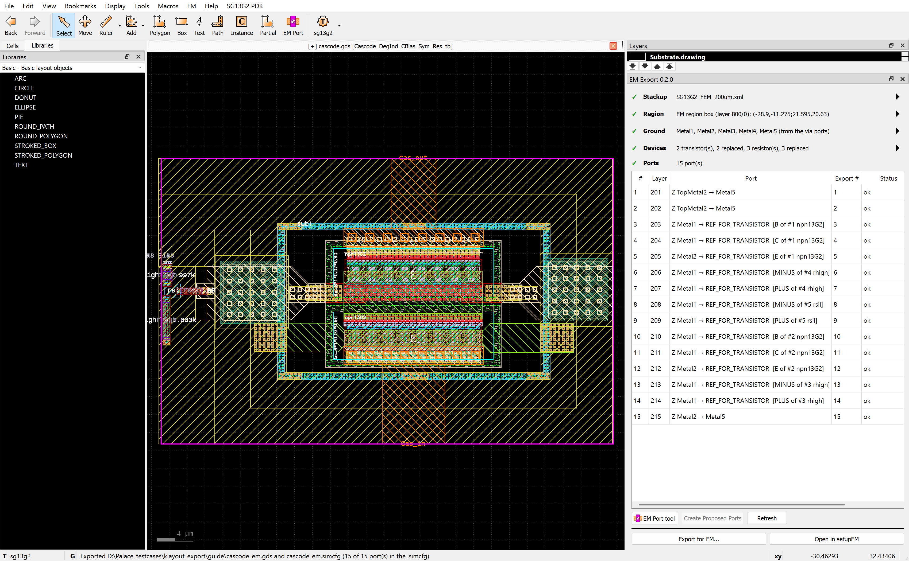

# klayout_em_export

**Set up EM simulations where you draw: in KLayout.** A plug-in for RFIC designers that turns part of a layout into a
[Palace](https://github.com/VolkerMuehlhaus/gds2palace_ihp_sg13g2) or
[openEMS](https://github.com/VolkerMuehlhaus/gds2openEMS) model, made for the IHP SG13G2 PDK.

- **Ports in your layout:** click a metal edge; the settings are saved with the layout.
- **Simulate only the part that matters:** ports are proposed where the region cuts conductors.
- **Split a large region into pieces:** each piece is its own model, setupEM joins the results at calibrated cuts and
  reuses the pieces that did not change.
- **Back to your circuit:** transistors and resistors become ports, and the result returns as a circuit with the PDK
  devices, for ngspice, VACASK or Xyce (Palace only).
- **Fewer wasted runs:** checks for ground, shorted ports and floating device terminals before you simulate.
- **Tape-out layouts made simulation-ready:** removes dummy fill and fills density holes (60 GHz PA: 2899 → 387 metal
  polygons).
- **Thermal from the same layout:** one heat source per device, named from LVS (experimental).



## Status

Version 0.2.1, in active development. SG13CMOS5L works like SG13G2. Ports, the export and the checks work with any
gds2palace or gds2openEMS stackup; device recognition needs a [technology module](doc/ARCHITECTURE.md#technologies).

| To use | You need |
| --- | --- |
| EM export, device replacement, Create Circuit | gds2palace 0.9.3 or newer, setupEM 0.16 or newer (both on PyPI), snp2le |
| openEMS models | gds2openEMS, with an openEMS stackup; open the export in EMStudio |
| Open in EMStudio | EMStudio with the `.simcfg` import ([PR #53](https://github.com/IHP-GmbH/EMStudio/pull/53), open) |
| Thermal (experimental) | gds2palace 0.9.4 or newer, setupEM 0.17 or newer (both on PyPI) |
| Export again into a setupEM that is already open | Unreleased: branch `klayout-handover` of [setupEM](https://github.com/volkermuehlhaus-claude/setupEM/tree/klayout-handover) |
| Port walls, split regions (pieces) | Unreleased: gds2palace 0.10.0 (port wall calibration) and setupEM with the split region support (branches `calibrated-deembedding` and `portwall` of the forks) |

## Install

1. [KLayout](https://www.klayout.de) 0.29 or newer (tested: 0.29.4 on Windows, 0.30.12 on Linux) with the
   [IHP SG13G2 PDK](https://github.com/IHP-GmbH/IHP-Open-PDK).
2. `pip install setupEM snp2le` in a Python environment. Palace runs on Linux, see gds2palace.
3. Clone this repo and link it into KLayout's package folder, then restart KLayout:

   ```powershell
   # Windows, PowerShell
   New-Item -ItemType Junction -Path "$HOME\KLayout\salt\klayout_em_export" -Target <path to this repo>
   ```

   ```bash
   # Linux
   ln -s <path to this repo> ~/.klayout/salt/klayout_em_export
   ```

KLayout now has an **EM** menu, an **EM Port** button and the EM panel.

## Try it

Open the cascode `tests/data/1_St_Core_v1_forEM.gds` and go through the panel from top to bottom:

1. **Stackup:** choose `SG13G2_FEM_200um.xml` from gds2palace.
2. **Ports:** click a pad's metal edge with the **EM Port** tool.
3. **Devices:** press **Replace All**.
4. **Export for EM...** opens setupEM with your model. Run Palace.
5. **EM > Create Circuit from EM Result...** gives the circuit for your testbench.

## Documentation

- [User's guide](doc/userguide/klayout_em_export_userguide.md): step by step with screenshots, for designers. PDF:
  [Windows](doc/userguide/klayout_em_export_userguide.pdf), [Linux](doc/userguide/klayout_em_export_userguide_linux.pdf).
- [Reference](doc/REFERENCE.md): every panel step, menu item and rule; the circuit wrapper; the headless JSON interface.
- [Cascode test report](doc/test_cascode_wrapper/README.md): from layout to circuit, with results.
- [Architecture](doc/ARCHITECTURE.md): modules, data formats and design decisions.
- [AGENTS.md](AGENTS.md): working rules, tests and KLayout pitfalls for development.
- [Link prototype](doc/LINK_PROTOTYPE.md): driving the plug-in from another program, tried and dropped.

## Known limits

- Device recognition: IHP SG13G2 and SG13CMOS5L cells only. Device replacement is for Palace only.
- Capacitors and inductors are never replaced, and neither is a resistor of several segments.
- The Spectre circuit is written but not tested.
- A layout saved after **Fill Density Holes** must not go to tape-out.
- A split region's joined result has no coupling between the pieces other than through the lines that cross the
  cuts: cut across simple feed lines, not between coupled parts.
- Thermal: resistor temperatures are not validated yet, and the comparison with the `rth` of IHP's npn13G2
  model is not settled. Use the temperatures as estimates, and for comparing devices and layouts.

More in the [guide's limits](doc/userguide/klayout_em_export_userguide.md#limits).

## Tests

```bash
tests/setup_pdk.sh       # once: a small checkout of the IHP PDK in tests/pdk (or set IHP_PDK_ROOT)
python tests/run_all.py  # all batch tests in KLayout, one table, about 3 minutes
```

They need the [gds2palace repo](https://github.com/VolkerMuehlhaus/gds2palace_ihp_sg13g2) next to this one, or in
`GDS2PALACE`. Tests whose inputs are not in the repo are reported as skipped.

## License

[GPL-3.0](LICENSE).
