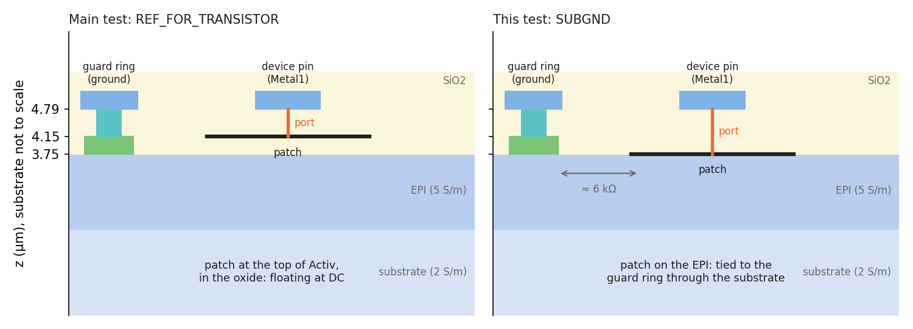
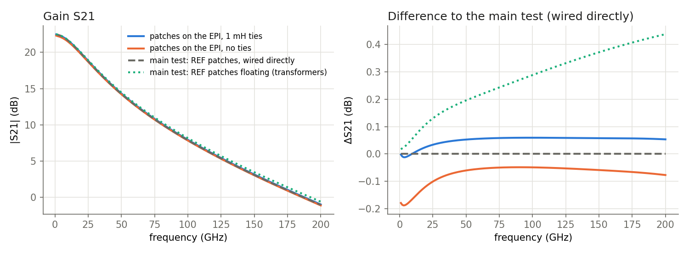

# Cascode test, variant: device reference patches on the EPI

The [main cascode test](../test_cascode_wrapper/README.md) puts each replaced device's ports on a REF_FOR_TRANSISTOR
patch. That patch floats in the oxide. At DC it has no connection, so the EM model does not fix the potential of a
device as a whole, and the circuit needs 1 mH ties between the ports of each net.

This variant puts the patches on the EPI instead, where the substrate ties them to the grounded guard ring. The
question: does that make the ties unnecessary, and what does it change at RF?

Date: 2026-10-30. Same layout, stackup, Palace settings and testbench as the main test; only the patches differ.

## Summary

- **The patches get a DC potential:** each is tied to the guard ring through the substrate, about 6 kΩ for the
  transistors and 18 to 20 kΩ for the resistors.
- **The ties are no longer needed for the devices' potentials.** Without them, Q1's emitter sits at 4 mV (main
  test: −0.40 V). The circuit is then only the EM model and the devices on its pins.
- **Without the ties, the wires' DC resistance acts:** about 0.4 Ω in Q1's emitter path and 0.9 Ω from the Vcc pad to
  Q2's collector. Icc drops from 11.34 mA to 10.67 mA (−6 %), and S21 by 0.05 to 0.19 dB. The ties short these
  resistances out.
- **RF with the ties:** within 0.06 dB of the main test.

## What changed

The patch moves from REF_FOR_TRANSISTOR (z = 4.15 µm, the top of Activ, in the oxide) down to SUBGND, the stackup's
PEC sheet on the EPI (z = 3.75 µm). The device ports run from the pins down to it, 0.4 µm longer than before. The
cell's ptap guard ring (Activ on the EPI, contacts up to the ground metal) ties the EPI to ground.

The export script is `tests/run_cascode_epitie_export.py`. It replaces the devices as the plug-in does, then moves the
patches to SUBGND and changes the ports' "to" layer. The plug-in itself is unchanged.

Two things did not work as first planned:

- **Activ under the REF patch**, to wire it down to the EPI, makes Palace abort: the patch lies on Activ's top face, so
  that face carries two boundaries (Activ's surface impedance and the PEC sheet). SUBGND avoids the overlap.
- **SUBGND is GDS layer 250**, inside the plug-in's port layer range 201 to 299. The plug-in took the patches for an
  extra port (layout port 50). Fixed since: the plug-in leaves the stackup's own layers out of the port layer range
  (SUBGND is 250 in the SG13G2 stackups and 210 in the SG13CMOS5L ones).

Palace ran the frequencies gds2palace sets up for a sweep from 0 Hz (10 MHz, 20 MHz, then 1 to 200 GHz), order 1,
adaptive sweep. The result is passive and reciprocal.

## The patches' path to ground

From the EM data: raise one device's patch by 1 V against everything else and read the current.

| Patch | Resistance to ground (10 MHz) | Capacitance |
| --- | --- | --- |
| Q1, Q2 (npn13G2, Nx = 8) | 6.0 kΩ, 6.4 kΩ | 7.3 fF |
| rhigh 3 kΩ, rsil, rhigh 13 kΩ | 19.8 kΩ, 18.5 kΩ, 17.7 kΩ | 1.7 to 2.2 fF |

The resistors lie outside the guard ring, so their path through the substrate is longer. The resistance barely
changes up to 100 GHz (5.5 kΩ for Q1). A device's port currents add up to zero at its patch, so no DC current flows
through this resistance: it only sets the patch's potential.

## Results

The circuit is the one from the main test: `tools/spice_wrapper.py` on the `_dc` file, devices wired directly to the
EM pins, run once with the 1 mH ties and once without.

| | patches on the EPI, ties | patches on the EPI, no ties | main test, ties | main test, no ties |
| --- | --- | --- | --- | --- |
| Icc | 11.34 mA | 10.67 mA | 11.34 mA | 10.67 mA |
| Cas_Bias current | 127.4 µA | 126.5 µA | 127.4 µA | 126.4 µA |
| Q1 emitter (ground net) | 0 V | 4 mV | 0 V | −0.40 V |
| Q2 collector (Vcc net, 2.5 V) | 2.500 V | 2.490 V | 2.500 V | 1.40 V |
| S21 at 10 / 60 / 100 / 200 GHz (dB) | 21.62 / 12.84 / 7.95 / −0.97 | 21.46 / 12.73 / 7.84 / −1.10 | 21.62 / 12.78 / 7.89 / −1.02 | 21.45 / 12.66 / 7.77 / −1.17 |

- **With the ties**, the variant is within 0.06 dB of the main test.
- **Without the ties**, the devices now sit at the right potentials. In the main test they drifted by up to 1.1 V.
- **Icc is 10.67 mA without ties in both runs.** So the 6 % drop is not due to the patches: it comes from the wires'
  DC resistance in the EM model, which the ties short out. Q1's emitter rises 4 mV above ground (about 0.4 Ω at
  10.7 mA), and that lowers its Vbe. Whether the EM model's DC resistance of the wires is accurate was not checked:
  it depends on the conductor model at 10 MHz (here the surface impedance model).
- The floating patches with transformers (main test) stay up to 0.44 dB higher at 200 GHz. Both direct-wired
  versions ground the patches, by wire or by substrate.

## Findings

1. **Patches on the EPI make the circuit self-contained:** EM model plus devices, no ties. The bias then includes
   the wires' DC resistance.
2. **With ties, the EPI patches change nothing worth noting** (≤ 0.06 dB). The ties remain the simpler way to get
   exact, resistance-free DC paths.
3. **To use EPI patches in the plug-in**, the replacement would draw the patch on SUBGND. (The port layer range
   already leaves SUBGND out.)

## Files

Scratchpad (not in the repo): `epitie/` with the export, Palace model, result, `analysis.py`, `plot.py` and
`xsection.py`. In the repo: `tests/run_cascode_epitie_export.py`.
