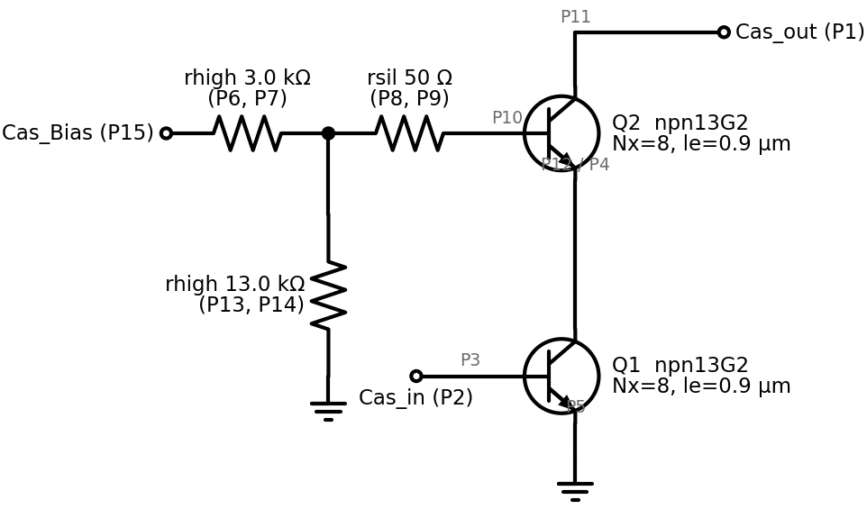
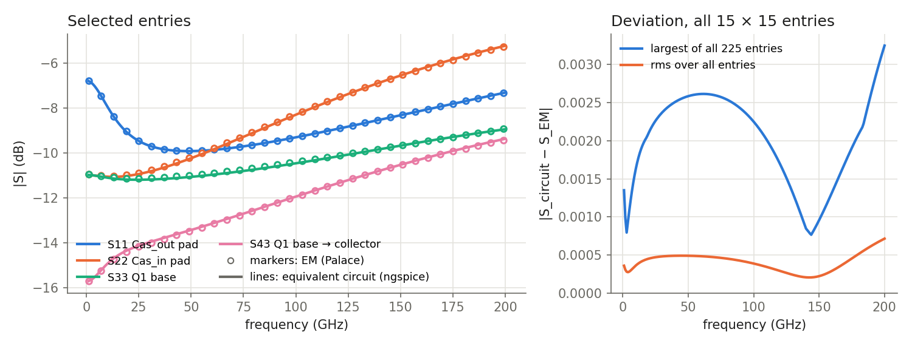
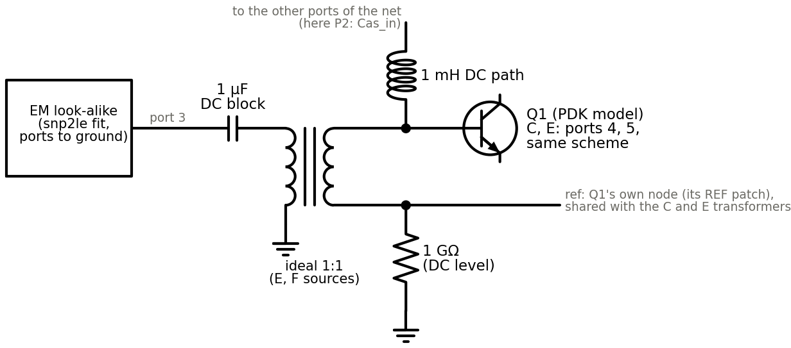
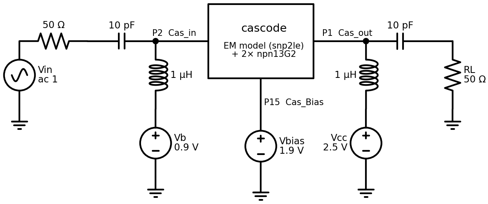

# Cascode test: EM model with the PDK transistors put back

This test takes one layout through the whole chain:

- export from KLayout, with the devices replaced by via ports;
- a Palace run;
- an equivalent circuit of the EM result (snp2le);
- an ngspice circuit with the PDK transistors and resistors put back at their ports.

It answers three questions: does the circuit give a sensible operating point and gain, which parts of the wrapper are
needed, and how good the DC behaviour of the EM model is.

Date: 2026-10-30. Tools: klayout_em_export (commit `4b6b426`), gds2palace 0.9.3, Palace 0.18, snp2le 0.1.15,
ngspice-46, IHP SG13G2 models (IHP-Open-PDK `3f66c913`).

## Summary

The circuit works: Icc = 11.3 mA at a sensible operating point, and S21 = 21.7 dB at 10 GHz, 8.2 dB at 100 GHz,
−0.6 dB at 200 GHz.

The wrapper adds three things around the EM model. What each is for, and what leaving it out costs in this test:

| Part | Why | Without it |
| --- | --- | --- |
| 1:1 transformer per device port | A device port is measured against that device's own floating REF patch, but the SPICE model of the EM result references every port to ground. The transformer moves the port's reference to a node of its own. | S21 −0.06 dB at 10 GHz, −0.4 dB at 200 GHz. Operating point unchanged. |
| 1 mH ties between the ports of each net, and to ground for the ground net | A port measures a voltage difference, so the EM model never says at what potential a device sits as a whole. The ties put each device terminal on its net's potential. | Each device floats: Q1's emitter is at −0.40 V instead of 0 V, and Q2's collector at 1.40 V instead of 2.5 V. |
| 1 µF DC block at each port | Keeps the EM model out of the DC solution. | No change, if the equivalent circuit is pinned to a 0 Hz point (as here). Without a 0 Hz point: bias current +26 %. |

DC: the EM data and its extrapolated 0 Hz point are good, and the equivalent circuit keeps that 0 Hz point. This
needs the sweep to start at 0 Hz in gds2palace, and the `_dc` file as snp2le's input.

## The layout and its ports

The cell is a cascode core from `1_St_Core_v1_forEM.gds`: two npn13G2 (Nx = 8, le = 0.9 µm) with a resistive bias
divider for the upper base. The plug-in replaced every device by via ports to its own REF_FOR_TRANSISTOR patch, as
follows:

- each transistor gets three ports (B, C, E);
- each resistor gets two ports;
- the pads Cas_in and Cas_out get one port each;
- a Cas_Bias port was added by hand.

That makes 15 ports in total.


The circuit that the wrapper rebuilds around the EM model:



Palace solved the frequencies that gds2palace sets up for a start frequency of 0 Hz: 10 MHz and 20 MHz, then 1 to
200 GHz in 1 GHz steps. It used order 1 and the adaptive frequency sweep, and took about 13 minutes on hpz2.
`combine_extend_snp` then wrote the S-parameters and the `_dc` file, which adds a 0 Hz point extrapolated from 10 MHz
and 20 MHz. The result is reciprocal and passive, and its couplings follow the nets traced in the layout.

## Step 1: an equivalent circuit for the EM result

snp2le (universal mode) turns the `_dc` file into a SPICE circuit: a vector fit of order 6 with 5 poles, passivity
enforced, and pinned to the 0 Hz point. To check it, the circuit itself was simulated as a 15-port in ngspice and
compared with the Palace data:



The largest deviation over all 225 S-parameters is 0.0033 between 1 and 200 GHz, and 0.0015 at 10 MHz and 20 MHz.
The rms deviation is 0.0004.

## Step 2: wiring the devices back

The parts from the summary, shown for one port (the base of Q1):



The generated netlist (`tools/spice_wrapper.py`), shortened. `XEM` is the equivalent circuit, with one pin per port
and every port referenced to ground (node 0). The subcircuit's pins are the ports that belong to no device:

```spice
.subckt cascode port1 port2 port15
XEM e1 e2 e3 e4 e5 e6 e7 e8 e9 e10 e11 e12 e13 e14 e15 lowf_dcpin_le

* pads (referenced to ground in the EM model too): only a DC block
Cdc1 port1 e1 1u
Cdc2 port2 e2 1u
Cdc15 port15 e15 1u

* Q1: ports 3 (B), 4 (C), 5 (E), all measured against Q1's REF patch -> node ref1
* per port: E copies V(terminal) - V(ref1) to the EM side, V senses the EM port current,
* F draws that current from the terminal and returns it to ref1 (together: an ideal 1:1 transformer)
E3 a3 0 n3 ref1 1
V3 a3 b3 0
Cdc3 b3 e3 1u
F3 n3 ref1 V3 1
E4 a4 0 n4 ref1 1
V4 a4 b4 0
Cdc4 b4 e4 1u
F4 n4 ref1 V4 1
E5 a5 0 n5 ref1 1
V5 a5 b5 0
Cdc5 b5 e5 1u
F5 n5 ref1 V5 1
Rref1 ref1 0 1G                     ; DC level of the floating reference
X1 n4 n3 n5 0 npn13G2 Nx=8 Ny=1 le=0.9u we=0.07u    ; C B E substrate

* Q2 (ports 10, 11, 12 -> ref2) and the resistors (ports 6-9, 13, 14 -> ref3..ref5) the same way, e.g.
R3 n14 n13 13.003k                  ; rhigh: static cell, ideal resistor of its label value

* DC paths of the wiring: the ports of each layout net tied together, the ground net to node 0
Ldc0_0 port1 n11 1m                 ; Cas_out pad - Q2 collector
Ldc1_0 0 n5 1m                      ; ground - Q1 emitter
Ldc1_1 n5 n14 1m                    ; Q1 emitter - rhigh 13k
Ldc2_0 port2 n3 1m                  ; Cas_in pad - Q1 base
Ldc3_0 n4 n12 1m                    ; Q1 collector - Q2 emitter
Ldc4_0 n6 port15 1m                 ; rhigh 3k - Cas_Bias pad
Ldc5_0 n7 n9 1m                     ; divider tap: rhigh 3k - rsil
Ldc5_1 n9 n13 1m                    ;              rsil - rhigh 13k
Ldc6_0 n8 n10 1m                    ; rsil - Q2 base
.ends cascode
```

The testbench: 50 Ω source and load with DC blocks, bias tees on the input and output. The bias values are estimates,
not taken from the design.



## Step 3: result

Operating point: Icc = 11.34 mA, Cas_Bias draws 127 µA, the base current of Q1 is 20 µA. Q1 has Vbe = 0.900 V and
Vce = 0.637 V; Q2 has Vbe = 0.881 V and Vce = 1.863 V.


| | 10 GHz | 60 GHz | 100 GHz | 200 GHz |
| --- | --- | --- | --- | --- |
| S21, device references floating (with transformers) | 21.68 dB | 13.00 dB | 8.18 dB | −0.58 dB |
| S21, device references grounded (no transformers) | 21.62 dB | 12.78 dB | 7.89 dB | −1.02 dB |

The core is unmatched (S11 and S22 are between −0.1 and −3 dB): there are no matching networks in the cell.

## Step 4: DC

An isolated net, such as the short wire between rsil and Q2's base (ports P8 and P10), has no DC path to anything
else. To test each net, raise it by 1 V against everything else and measure the current into it. In the layout the
current is zero. Expressed as a leakage resistance, at each stage of the chain (lowest and highest of the six nets):

| Stage | Leakage per net |
| --- | --- |
| EM data at 10 MHz | 13 MΩ to 32 GΩ |
| EM data at 20 MHz | 204 MΩ to 15 GΩ |
| `_dc` file, 0 Hz point extrapolated from 10 + 20 MHz | 6.5 MΩ to 25 GΩ |
| snp2le fit of the `_dc` file, pinned to its 0 Hz point | 6 MΩ to 50 MΩ |
| snp2le fit of the data without the 0 Hz point | 35 kΩ to 55 kΩ |

What the bias network needs: the divider has 3 kΩ and 13 kΩ, so for 1 % accuracy every leak must be above about
1.3 MΩ. Against 50 Ω that is a change of about 1e-4 in S.

- The EM data meets this by far.
- So does the 0 Hz point that `combine_extend_snp` extrapolates from 10 MHz and 20 MHz (scikit-rf's
  `extrapolate_to_dc`, linear in magnitude and phase from the first two points).
- snp2le pins its fit to that point. It moved the point by 1.5e-3 to make it strictly passive, and the leakage
  stays above 6 MΩ.
- Without a 0 Hz point, snp2le fits all 202 frequency points with the same weight, and its DC misses the needed
  1e-4 by far, although 10 MHz and 20 MHz are in the data.

The circuit with and without the DC blocks and the ties (equivalent circuit pinned to the 0 Hz point unless noted):

| | full wrapper | ties, no DC blocks | neither | ties, no DC blocks, fit without 0 Hz point |
| --- | --- | --- | --- | --- |
| Cas_Bias current | 127 µA | 127 µA | 126 µA | 160 µA |
| Icc | 11.34 mA | 11.34 mA | 10.67 mA | 11.30 mA |
| Q1 emitter (on the ground net) | 0 V | 0 V | −0.40 V | 0 V |
| Q2 collector (on the Vcc net, 2.5 V) | 2.50 V | 2.50 V | 1.40 V | 2.50 V |
| S21 at 10 / 100 GHz | 21.68 / 8.18 dB | 21.68 / 8.18 dB | 21.51 / 8.07 dB | 21.64 / 8.08 dB |

With the pinned equivalent circuit, the DC blocks change nothing. The ties are needed in every case. Without them,
each device's absolute potential is left to the EM model, which does not define it: a REF patch has no DC connection
to ground.

### P15 is reversed in the EM model

gds2palace hands the direction `Z` to Palace as +z, so the upper conductor of a via port is its positive terminal.
All ports have their signal metal on top, except P15: its signal metal is Metal2, below its ground plane Metal5. The
EM model therefore sees P15 reversed, and the wrapper does not know that.

The ideal DC network built from the layout matches the EM data only with P15 reversed. The variants in Step 4 have
P15 inverted in the wrapper. Steps 1 to 3 use the wrapper as generated, which gives identical results either way.

Without the inversion:

- **The full wrapper is unaffected.** P15 is behind a DC block and driven by an ideal source there.
- **Ties without DC blocks:** the 1.9 V Cas_Bias source drives 0.96 A.
- **Without ties:** the bias collapses, and S21 is −49 dB at 10 GHz.

## Findings

1. **The circuit works.** With floating device references, DC ties, and the PDK models, the cascode gives a sensible
   operating point and plausible gain to 200 GHz.
2. **The DC of the EM model is good**, if the Palace sweep starts at 0 Hz in gds2palace and snp2le gets the `_dc`
   file. Then the DC blocks are not needed; the ties and the transformers are.
3. **Bug: the wrapper ignores port polarity.** A via port whose signal metal is below its reference (P15 here, and
   possibly boundary ports to a ground above them) is reversed in the EM model. Fix: the export chooses `-Z` for such
   ports, or the port map records the polarity and the wrapper inverts them.
4. **snp2le without a 0 Hz point:** its DC is not good enough for a bias network, even with 10 MHz in the data. An
   option worth considering: pin to, or weight, the lowest sample when it is close to DC.
5. **gds2palace: the `_dc` file carries no mark.** `combine_extend_snp` passes the comment "DC point added by
   extrapolation" to `write_touchstone`, but the file does not contain it. It also resamples the whole sweep onto a
   new uniform grid (0, 0.99, 1.98, … GHz). A tool reading the file cannot tell which points are simulated.
6. **The wrapper's documentation needs updating.** `tools/spice_wrapper.py` and the README say an S-parameter fit
   does not keep the DC paths. With a 0 Hz point it does.

## Files

The scripts and data are in the session scratchpad (not in the repo):

- `cascode_palace/`: the export, model, and Palace result (`result_lowf`);
- `wrapper/`: the generated circuits and testbenches;
- `report/`: the checks and plots (`fitcheck_fd.py`, `amp_fd.py`, `variants.py`, `dccheck.py`, `lowf.py`,
  `plots_fd.py`, `schem.py`, `layout_fig.py`).
