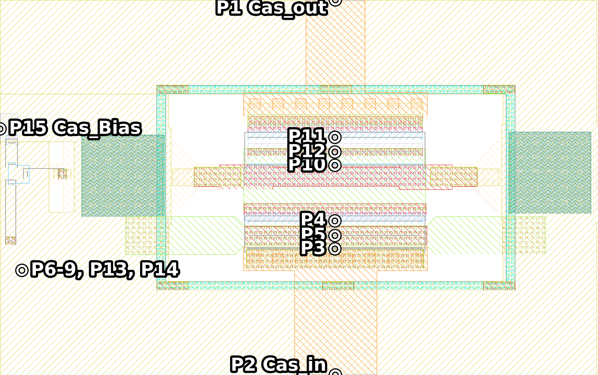
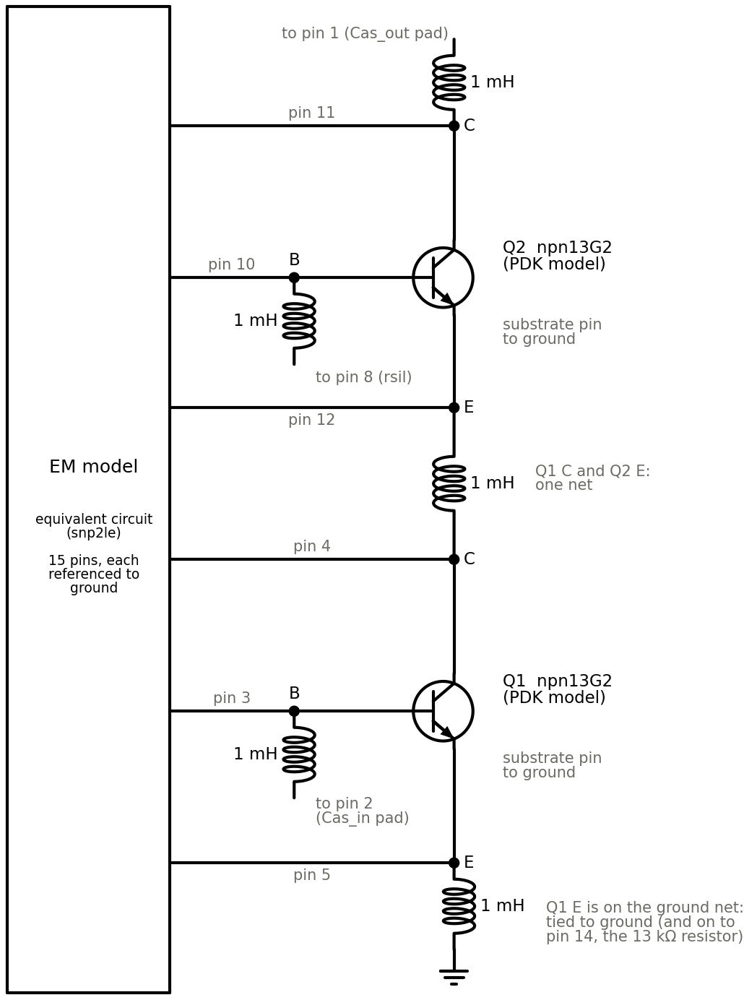
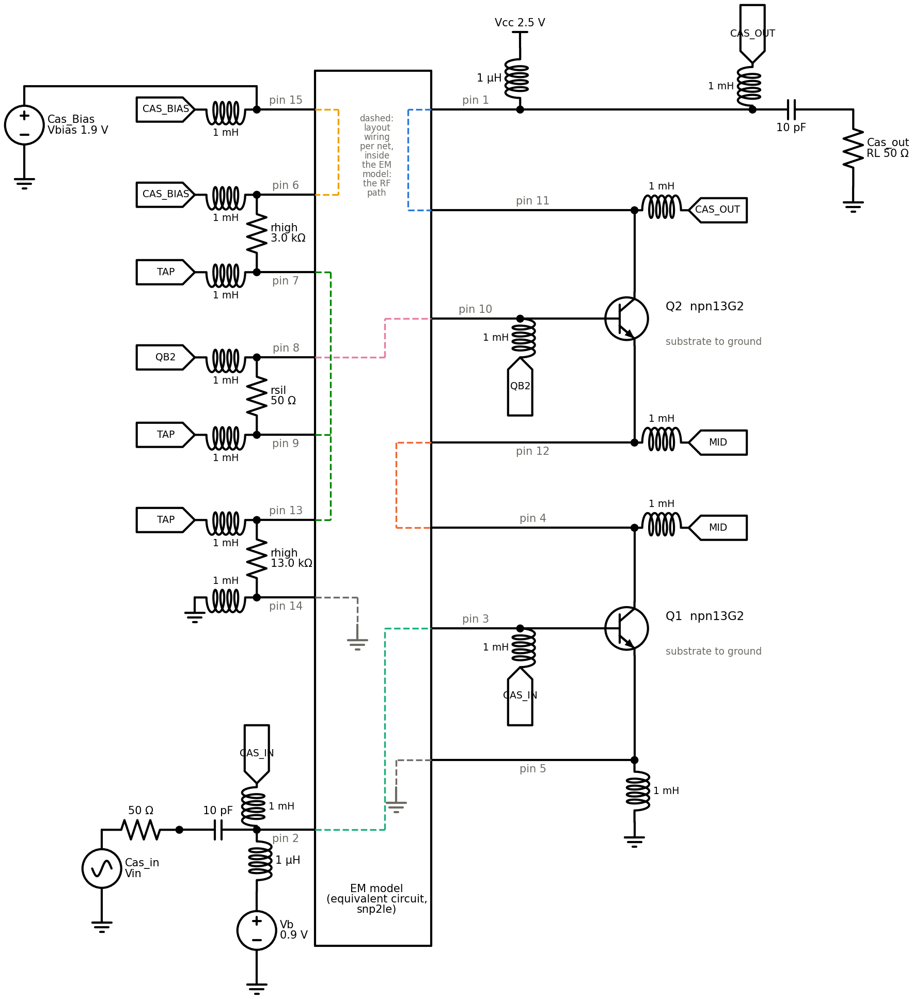
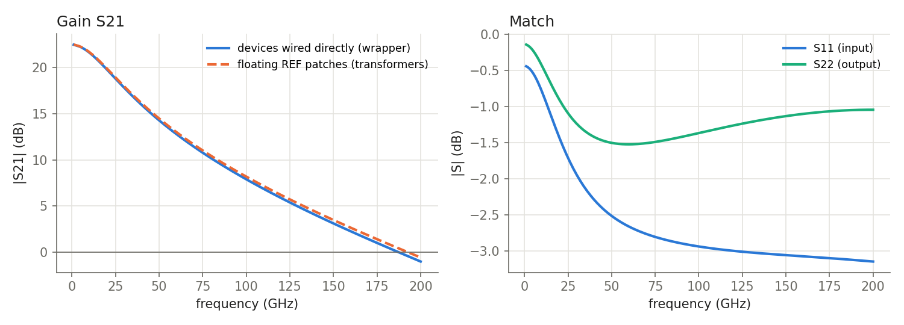

# Cascode test: EM model with the PDK transistors put back

This test takes one layout through the whole chain:

1. Export the layout from KLayout, with the transistors and resistors replaced by ports.
2. Simulate it in Palace.
3. Turn the EM result into a SPICE circuit (snp2le).
4. Put the PDK transistors and resistors back at their ports, and simulate the amplifier in ngspice.

Date: 2026-10-30. Tools: klayout_em_export, gds2palace 0.9.3, Palace 0.18, snp2le 0.1.15, ngspice-46, IHP SG13G2
models (IHP-Open-PDK `3f66c913`).

## Summary

- **The chain works.** The cascode reaches a sensible operating point (Icc = 11.3 mA) and a plausible gain:
  S21 = 21.6 dB at 10 GHz, 7.9 dB at 100 GHz, −1.0 dB at 200 GHz.
- **The circuit around the EM model is simple:** each device pin is wired straight to its pin of the EM model, and
  1 mH inductors tie the pins of each net together (and the ground net to ground), so that the bias reaches the
  devices. Nothing else is needed, provided the EM model has a good 0 Hz point.
- **A good 0 Hz point** comes from gds2palace with the sweep started at 0 Hz: it adds 10 MHz and 20 MHz and writes a
  `_dc` file with a 0 Hz point extrapolated from them. snp2le keeps that point.
- **Port polarity matters.** A via port is positive at its upper metal. The export now sets each port's direction so
  that its signal metal is the positive end.

## 1. The layout and the circuit

The cell is a cascode core from `1_St_Core_v1_forEM.gds`: two npn13G2 (Nx = 8, le = 0.9 µm) and a resistor divider
that biases the upper base. The export replaced each device by via ports from its pins down to a small metal sheet
under the device, its REF patch (one per device):

- each transistor: three ports (B, C, E);
- each resistor: two ports;
- the pads Cas_in and Cas_out: one port each;
- the bias input Cas_Bias: one port, added by hand.

That makes 15 ports in total.



The circuit, with the port numbers at each device terminal:


## 2. The EM simulation

Palace simulated 10 MHz and 20 MHz, then 1 to 200 GHz in 1 GHz steps: the frequencies gds2palace sets up for a sweep
from 0 Hz. It used order 1 and the adaptive frequency sweep, and took about 13 minutes.
`combine_extend_snp` then wrote the S-parameters, and the `_dc` file with a 0 Hz point extrapolated from 10 MHz and
20 MHz.

## 3. The EM model as a SPICE circuit

snp2le (universal mode) turns the `_dc` file into an equivalent circuit: a vector fit of order 6 with 5 poles,
passive, pinned to the 0 Hz point. It has one pin per port, and each port is referenced to ground.

To check it, the equivalent circuit was simulated as a 15-port in ngspice and compared with the Palace data. The
largest deviation over all 225 S-parameters is 0.0033 between 1 and 200 GHz, and 0.0015 at 10 MHz and 20 MHz. The
rms deviation is 0.0004.


## 4. Putting the devices back

`tools/spice_wrapper.py` builds the circuit from the equivalent circuit and the port map that the export writes.
Everything connected to the two transistors:



- **Device pins to EM pins.** Each transistor's base, collector and emitter connect directly to its pins of the
  equivalent circuit: pins 3, 4 and 5 for Q1, pins 10, 11 and 12 for Q2. The substrate pins go to ground.
- **DC ties (1 mH).** Every terminal is tied to the other ports of its layout net, which the export traces through
  the vias:
  - Q2's collector to the Cas_out pad (pin 1);
  - Q2's base to the rsil resistor (pin 8);
  - Q1's collector to Q2's emitter, which are one net;
  - Q1's base to the Cas_in pad (pin 2);
  - Q1's emitter, on the ground net, to ground.

  At DC the ties are shorts and carry the bias. At RF they are open (1 mH is 6 kΩ at
  1 MHz and 63 kΩ at 10 MHz), and only the EM model is left.

The whole netlist:

```spice
.subckt cascode port1 port2 port15
XEM port1 port2 n3 n4 n5 n6 n7 n8 n9 n10 n11 n12 n13 n14 port15 cascode_le   ; EM model, pins 1..15
X1 n4 n3 n5 0 npn13G2 Nx=8 Ny=1 le=0.9u we=0.07u     ; Q1: C B E substrate
X2 n11 n10 n12 0 npn13G2 Nx=8 Ny=1 le=0.9u we=0.07u  ; Q2
R3 n14 n13 13.003k                                    ; resistors: static cells, ideal R from their label
R4 n7 n6 2.997k
R5 n9 n8 49.98
* DC ties: the ports of each layout net, and the ground net to ground
Ldc0_0 port1 n11 1m       ; Cas_out pad - Q2 collector
Ldc1_0 0 n5 1m            ; ground - Q1 emitter
Ldc1_1 n5 n14 1m          ; Q1 emitter - 13k resistor
Ldc2_0 port2 n3 1m        ; Cas_in pad - Q1 base
Ldc3_0 n4 n12 1m          ; Q1 collector - Q2 emitter
Ldc4_0 n6 port15 1m       ; 3k resistor - Cas_Bias pad
Ldc5_0 n7 n9 1m           ; divider tap: 3k - rsil
Ldc5_1 n9 n13 1m          ;              rsil - 13k
Ldc6_0 n8 n10 1m          ; rsil - Q2 base
.ends cascode
```

The testbench: 50 Ω source and load with DC blocks, bias tees at the input and output, and a 1.9 V source at
Cas_Bias. The bias values are estimates, not taken from the design.


The full circuit as simulated, with the testbench at the pads. Each 1 mH tie ends in its net's name (in the netlist
the ties of a net form a chain). Dashed inside the EM model: the layout's wiring between the pins of each net. That
is where the RF goes. Q2's collector signal, for example, enters the EM model at pin 11, follows the wire to the
Cas_out pad, and leaves at pin 1 towards the 10 pF and the load. The 1 mH from pin 1 to the CAS_OUT net carries only
the collector's DC current.



## 5. Result

Operating point: Icc = 11.34 mA, Cas_Bias draws 127 µA, the base current of Q1 is 20 µA. Q1 has Vbe = 0.900 V and
Vce = 0.637 V; Q2 has Vbe = 0.881 V and Vce = 1.863 V.



| | 10 GHz | 60 GHz | 100 GHz | 200 GHz |
| --- | --- | --- | --- | --- |
| S21 | 21.62 dB | 12.78 dB | 7.89 dB | −1.02 dB |

The core is unmatched (S11 and S22 between −0.1 and −3.2 dB): there are no matching networks in the cell.

## 6. Why the circuit is built this way

**Wiring the device pins directly grounds the REF patches.** In the EM model, each REF patch floats: it touches only
its own device's ports, and its potential follows the device. The equivalent circuit, however, references every port
to ground, so a device wired straight to it sees its REF patch at ground. That adds the patch's own capacitance to
its surroundings. From the EM data:

| REF patch | Capacitance at 10 MHz | at 10 to 200 GHz |
| --- | --- | --- |
| npn13G2, Nx = 8 | 10.8 fF | 7.0 fF, with substrate loss |
| rhigh, rsil | 1.5 to 2.3 fF | 1.1 to 1.7 fF |

For comparison, Q1's input capacitance at its operating point is 74 fF at 10 GHz.

The floating patches can be kept by coupling each device port through an ideal 1:1 transformer to a reference node of
its own. That gives S21 = 21.68 / 13.00 / 8.18 / −0.58 dB at 10 / 60 / 100 / 200 GHz, with the same operating point:
0.06 dB more at 10 GHz, and 0.44 dB more at 200 GHz, than with direct wiring (dashed line in the plot above). The
wrapper uses direct wiring, because the netlist is much simpler and the difference is small.

**Tying the REF patches to ground inside the EM model** would be the other way to make direct wiring exact. But the
tie runs from the device level up to the ground plane, and its inductance adds to every device port; for Q1's emitter
it acts as a fake emitter degeneration. Direct wiring in the circuit is roughly an ideal tie without that inductance,
so a real tie can only add error.

**One REF patch per device** keeps the added capacitance small. A single patch under the whole cell would add far more
than 7 fF per transistor.

**The DC ties are needed.** A port measures a voltage difference. At DC a REF patch has no connection, so the EM model
does not fix the voltage of a device as a whole. Without the ties the devices drift: Q1's emitter ends up at −0.40 V
although it is on the ground net, and Q2's collector at 1.40 V instead of 2.5 V.

**DC blocks are not needed with a good 0 Hz point.** The wrapper adds 1 µF in series with every EM pin only when the
.sNp has no 0 Hz point. The table compares these cases (devices wired directly in all):

| | ties | ties + DC blocks | no ties | ties, fit without 0 Hz point |
| --- | --- | --- | --- | --- |
| Cas_Bias current | 127 µA | 127 µA | 126 µA | 206 µA |
| Icc | 11.34 mA | 11.34 mA | 10.67 mA | 11.11 mA |
| Q1 emitter (ground net) | 0 V | 0 V | −0.40 V | 0 V |
| Q2 base | 1.52 V | 1.52 V | 0.43 V | 1.39 V |
| S21 at 10 / 100 GHz | 21.62 / 7.89 dB | 21.62 / 7.89 dB | 21.45 / 7.77 dB | 21.46 / 7.49 dB |

## 7. How good the DC of the EM model is

An isolated net, such as the short wire between rsil and Q2's base, has no DC path to anything else. To test each of
the six signal nets, raise it by 1 V against everything else and measure the current into it. In the layout the
current is zero; any current is a leak through the model. As a resistance (lowest and highest of the six nets):

| Stage | Leakage per net |
| --- | --- |
| EM data at 10 MHz | 13 MΩ to 32 GΩ |
| EM data at 20 MHz | 204 MΩ to 15 GΩ |
| `_dc` file, 0 Hz point extrapolated from 10 + 20 MHz | 6.5 MΩ to 25 GΩ |
| snp2le fit of the `_dc` file, pinned to its 0 Hz point | 6 MΩ to 50 MΩ |
| snp2le fit of the data without the 0 Hz point | 35 kΩ to 55 kΩ |

The bias divider has 3 kΩ and 13 kΩ, so for 1 % accuracy every leak must be above about 1.3 MΩ.

- **The EM data and the `_dc` point meet this by far.** `combine_extend_snp` extrapolates the 0 Hz point (scikit-rf's
  `extrapolate_to_dc`) linearly from the first two frequencies, here 10 MHz and 20 MHz.
- **snp2le keeps the point.** It pins the fit to it, after moving it by 1.5e-3 to make it strictly passive.
- **Without a 0 Hz point the fit is not good enough.** snp2le fits all 202 frequencies with the same weight, and its
  DC leaks through tens of kΩ, although 10 MHz and 20 MHz are in the data. In the circuit this raises the Cas_Bias
  current from 127 µA to 206 µA (table above).

## 8. Port polarity

gds2palace hands a via port's direction `Z` to Palace as +z, so the upper metal is the port's positive end. The
device ports and the pads have their signal metal on top. The Cas_Bias port (P15), however, runs from Metal2 up to
the ground plane on Metal5, so with `Z` its signal end was negative and the EM model saw it reversed. In the first
wrapper, with transformers, this went unnoticed with DC blocks. Without DC blocks the 1.9 V Cas_Bias source drove
0.96 A.

The export now chooses the direction from the layout. It traces which end of each via port is the signal and which
is the reference (the ground net or a REF patch), and writes `Z` or `-Z` so that the signal metal is the positive
end. P15 is now exported as `-Z`. The port map records the direction and the signal layer of each port.

The Palace run was not repeated with `-Z`. Instead, the sign of port 15 was flipped in the S-parameters (or port 15
inverted in the circuit), which is exactly what `-Z` changes. The results in this report hold for the corrected
polarity: the circuits either use the flipped port, or have port 15 behind a DC block and an ideal source, where its
sign does not matter.

## 9. Open points

- **snp2le without a 0 Hz point:** pinning to, or weighting, the lowest frequency when it is close to DC would make
  its DC usable without the `_dc` file.
- **gds2palace `_dc` file:** the comment "DC point added by extrapolation" does not reach the file, and the sweep is
  resampled onto a new grid (0, 0.99, 1.98, … GHz). A tool reading the file cannot tell which points were simulated.
- **Not modelled:** the wires' DC resistance (the ties are ideal), and the static resistor cells' parasitics and
  temperature behaviour (ideal resistors from their labels).

## Files

The scripts and data are in the session scratchpad (not in the repo):

- `cascode_palace/`: the export, model, and Palace result (`result_lowf`);
- `wrapper_b/`: the generated circuit and testbench;
- `report/`: the checks and plots (`fitcheck_fd.py`, `amp_fd.py`, `direct.py`, `dccheck.py`, `lowf.py`,
  `plots_fd.py`, `schem.py`, `schem_device.py`, `layout_fig.py`).
