# EM Simulation from KLayout: User's Guide for the klayout_em_export Plug-in

Volker Mühlhaus, volker@muehlhaus.com
---
Document version: 2026-11-03, plug-in version 0.2.0

## Contents
[What the plug-in does](#what-the-plug-in-does)
[Installation](#installation)
[A first run in 15 minutes](#a-first-run-in-15-minutes)
[The EM menu, the EM panel and the EM Port tool](#the-em-menu-the-em-panel-and-the-em-port-tool)
[The stackup](#the-stackup)
[Ports](#ports)
[Checks: ground and short circuits](#checks-ground-and-short-circuits)
[Choosing the region to simulate](#choosing-the-region-to-simulate)
[Transistors and resistors](#transistors-and-resistors)
[Export](#export)
[setupEM and the Palace run](#setupem-and-the-palace-run)
[Back to the circuit: Create Circuit](#back-to-the-circuit-create-circuit)
[The cascode example: results](#the-cascode-example-results)
[Troubleshooting](#troubleshooting)
[Reference](#reference)

## What the plug-in does

> **In this chapter:** what the plug-in is for, and how it fits between your layout and your circuit simulator.
>
> **Why it matters:** at mm-wave frequencies the wiring around a transistor is part of the circuit. Its inductance,
> capacitance and coupling change gain, matching and stability. The plug-in lets you put exactly that wiring into an
> EM simulation, and then put the transistors back in a circuit simulator.

An EM simulator such as Palace computes the electromagnetic behaviour of metal and dielectric. It cannot simulate a
transistor. A circuit simulator such as ngspice simulates the transistor with its PDK model, but knows nothing about
the wiring you drew. For a mm-wave amplifier you need both.

The plug-in connects the two worlds:

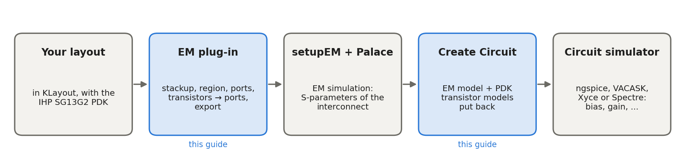

1. **In KLayout** you open your layout and mark what to simulate. The plug-in replaces each transistor by ports at
   its pins, places ports at the pads, and exports a clean layout for the EM simulation.
2. **Palace** (set up in setupEM or EMStudio) or **openEMS** (set up in EMStudio) simulates that layout. The result
   is an S-parameter file: the interconnect, seen from all ports.
3. **Create Circuit** builds a circuit from it: the EM result, with the PDK transistor models connected again at
   their ports.
4. **Your circuit simulator** (ngspice, VACASK, Xyce or Spectre) then simulates bias, gain and everything else, with
   the real wiring included.

This guide follows the Palace flow with setupEM, the one that puts the transistors back. For openEMS, see
[EMStudio instead of setupEM](#emstudio-instead-of-setupem) in chapter 11.

### What the plug-in does for you

Much of the work that makes an EM model tedious, and easy to get wrong, is done for you:

- **A via port in one click.** Click a metal edge: the port is placed exactly along that edge, and the port dialog
  offers only the metals that are really drawn there (chapter 6).
- **An in-plane port in one click.** Shift+click into a gap: the plug-in finds the gap between two shapes of one
  metal, draws the port across it and sets its direction and metal (chapter 6).
- **Ground found and checked.** The plug-in traces your metal through the vias, finds the ground net by itself and
  shows it in the layout. It warns you before the simulation if a port is shorted, does not reach ground, or if
  your layout has no ground at all (chapter 7).
- **Ports where the region cuts your wiring.** Simulate only part of the layout, and the plug-in proposes a port on
  every signal wire that leaves the region, from the wire to the ground metal there. Ground wires get no port
  (chapter 8).
- **Transistors replaced by ports.** The plug-in recognises the SG13G2 transistors and resistors, finds their
  terminals from the PDK cell (for a MOSFET it follows the gate to your contacts) and places one port per terminal,
  over all fingers. The reference patch covers only the device's pins, so two devices side by side keep separate
  references. The export removes the device's own metal below the pins, so nothing is counted twice: once in the
  EM model and once in the PDK model (chapter 9).
- **Connection checks for devices.** You are warned if a device terminal is not wired to anything in the region, or
  if the reference patches of two devices touch (chapter 9).
- **A clean export.** One flat cell, cut at the region, with only the layers the stackup needs, and a report of
  everything left out. Ports are numbered 1, 2, 3, ... without gaps, and all via ports point the same way, with the
  signal metal at the same end (chapter 10).
- **Back to the circuit in one step.** The export records which port belongs to which pin of which device. Create
  Circuit uses it to connect the PDK models again and writes the circuit for your simulator (chapter 12).
- **Settings kept with the layout.** The stackup, the port settings and your ground marks are saved in the GDS
  file. The EM panel shows with green, orange and red marks what is done and what is still missing (chapter 4).

This guide follows one example from start to end: a cascode core with two npn13G2 transistors, a bias divider of
three resistors, and two RF pads.

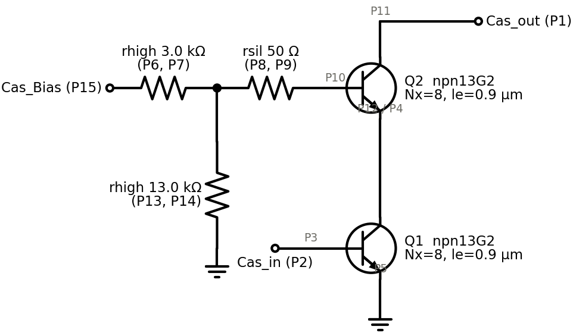

In the layout, the two transistors sit stacked in the middle, Q2 above Q1. The RF lines Cas_in and Cas_out leave at
the bottom and top, the bias resistors are at the left edge, and a large ground plane surrounds everything. This is
the layout you will prepare for the EM simulation in the following chapters.

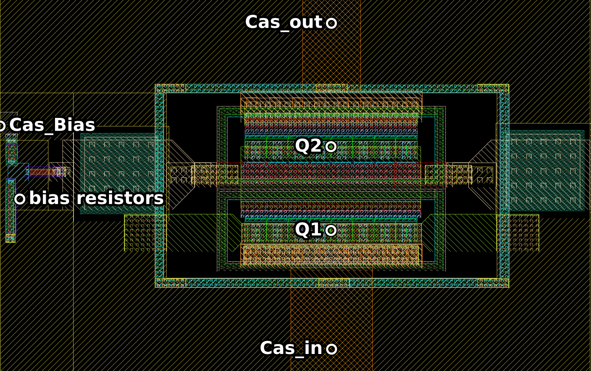

## Installation

> **In this chapter:** the software you need, and how to check that everything is in place.
>
> **Why it matters:** the plug-in works together with other tools: the IHP PDK in KLayout recognizes your
> transistors, gds2palace and setupEM build the EM model, and snp2le turns the result into a circuit.

You need:

| What | What for | How to get it |
| --- | --- | --- |
| KLayout 0.29 or newer | the layout editor the plug-in runs in | [klayout.de](https://www.klayout.de) |
| IHP SG13G2 PDK for KLayout | recognizes your transistors and resistors (PDK cells) | [IHP-Open-PDK](https://github.com/IHP-GmbH/IHP-Open-PDK), KLayout setup as described there |
| the plug-in | this guide | copy the `klayout_em_export` folder into KLayout's package folder (below) |
| a Python environment with setupEM | setupEM, gds2palace, snp2le | `pip install setupEM snp2le` (setupEM installs gds2palace) |
| Palace | the EM simulator, on Linux | see the gds2palace documentation |
| a circuit simulator | ngspice, VACASK, Xyce or Spectre | ngspice, VACASK and Xyce come with the IHP PDK models, e.g. in the IIC-OSIC-TOOLS image |

**Installing the plug-in:**

1. Close KLayout.
2. Copy the `klayout_em_export` folder into KLayout's package folder:
   - Windows: `%USERPROFILE%\KLayout\salt\`
   - Linux: `~/.klayout/salt/`
3. Start KLayout.

**Check:** the menu bar now has an **EM** menu, the toolbar an **EM Port** button, and the **EM Export** panel
opens on the right.

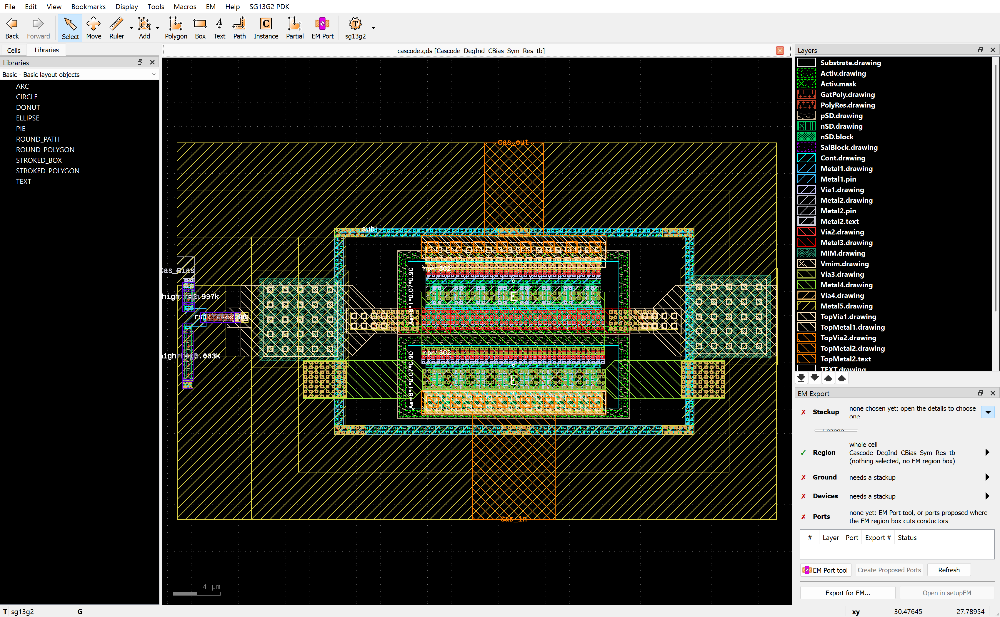

**What can go wrong:** no EM menu means KLayout did not find the plug-in: check that the folder is directly in `salt`
and contains `grain.xml`. If transistors are not recognized later (chapter 9), the IHP PDK is not loaded in KLayout.

## A first run in 15 minutes

> **In this chapter:** the whole flow in short, without explanations, so you see it work once.
>
> **Why it matters:** with the big picture in mind, the following chapters are easier to place. Each step here
> points to the chapter that explains it.

1. Open your layout in KLayout. Choose the stackup: **EM > Choose Stackup...**, e.g. `SG13G2_FEM_200um.xml` from
   gds2palace (chapter 5).
2. Place a port at each pad with the **EM Port** tool: click the edge of the pad metal (chapter 6).
3. Check the **Ground** line in the EM panel: it should show the ground metals with a green check (chapter 7).
4. In the panel's **Devices** line, open the details and press **Replace All** (chapter 9).
5. Press **Export for EM...** and **Export** (chapter 10). setupEM opens with your model.
6. In setupEM, set the frequencies, starting at **0 GHz**, create the model and run Palace (chapter 11).
7. Back in KLayout: **EM > Create Circuit (EM Result with Devices)...**, choose the result `_dc.sNp` and your
   simulator (chapter 12).
8. Include the circuit file in your testbench and simulate (chapter 12).

## The EM menu, the EM panel and the EM Port tool

> **In this chapter:** where to find the plug-in's functions.
>
> **Why it matters:** most of the work happens in the EM panel. It works like a checklist: a green check on each
> line means that step is ready.

**The EM menu** has all functions, top to bottom in the order you use them:

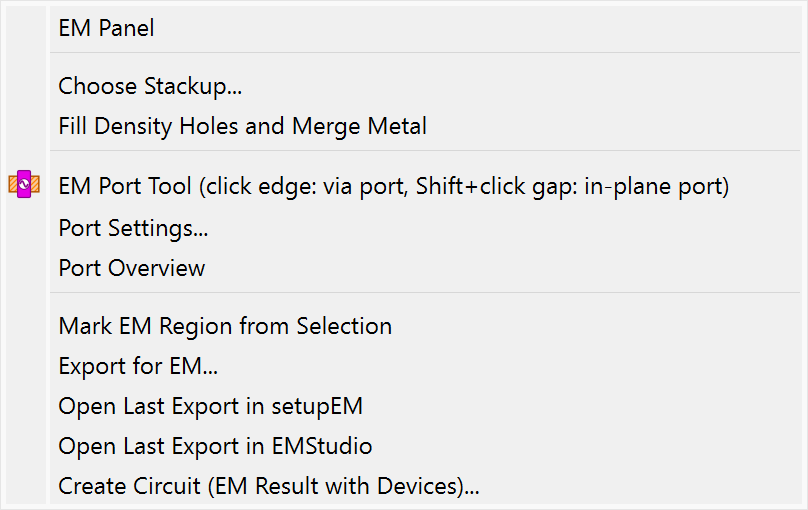

**The EM panel** (EM > EM Panel, if you closed it) shows the state of your layout:

- **Stackup**: the stackup file in use.
- **Region**: what will be exported: the whole cell, your selection, or the EM region box.
- **Ground**: the ground net and the checks on it.
- **Devices**: the transistors and resistors found, and how many are replaced by ports.
- **Ports**: all ports, as a table.

Each line has an arrow on the right. It opens the details, with the buttons for that step. Below the table are the
**EM Port tool**, **Create Proposed Ports** (chapter 8) and **Refresh**, and at the bottom **Export for EM...** and
**Open in setupEM**.

The marks mean:

| Mark | Meaning |
| --- | --- |
| ✓ (green) | ready |
| ⚠ (orange) | works, but check the details |
| ✗ (red) | missing: the export will not work, or not as intended |

**The EM Port tool** is the **EM Port** button in the toolbar. With it, a click on a metal edge creates a port
(chapter 6).

## The stackup

> **In this chapter:** choosing the stackup file.
>
> **Why it matters:** the stackup tells the EM simulator the height, thickness and material of every metal and
> dielectric layer. Every later step uses it: which metals can carry a port, how vias connect metals, which layers
> are exported.

At the start, the panel shows a red mark at **Stackup**:

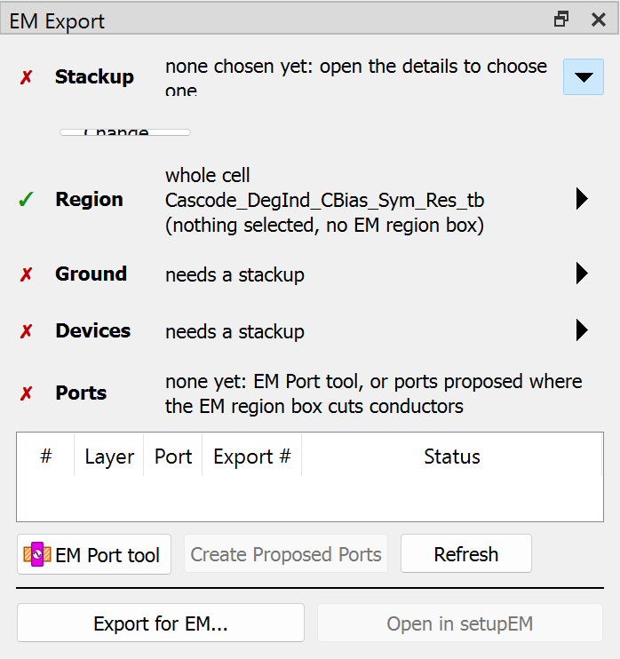

1. Open the details of the **Stackup** line (arrow on the right), or use **EM > Choose Stackup...**.
2. Press **Change...** and choose the stackup XML, e.g. `SG13G2_FEM_200um.xml` from gds2palace
   (`XML_stackup/latest/IHP/`).

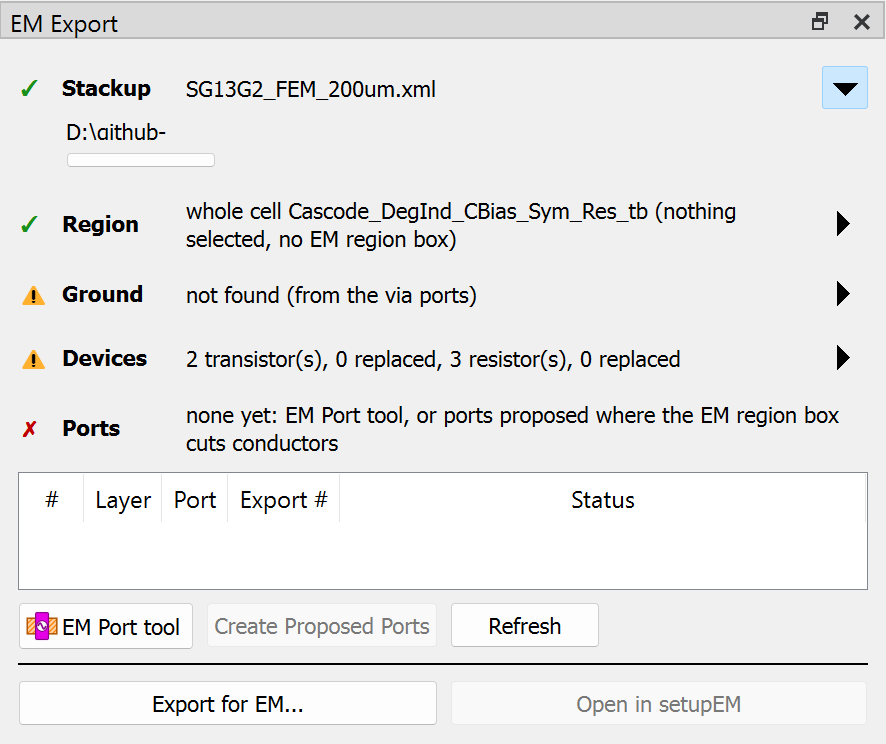

The stackup is stored with your layout, and used as the default for the next layout you open.

**What can go wrong:** use a stackup made for your simulator: from gds2palace for Palace, from gds2openEMS for
openEMS. They look similar but contain different modelling assumptions.

### Dummy metal fill

A layout ready for tape-out is full of dummy metal fill: tens of thousands of small tiles that clutter the view and
are hard to hide. **EM > Remove Dummy Fill** removes them from the current cell, in one undo step (**Edit > Undo**).

- **What counts as fill:** a shape on a metal of the stackup, on any datatype, that floats and repeats. It floats
  when nothing connects to it: no via of the stackup, no label, no port, and it is not part of a device. Markers on
  other datatypes, such as a no-fill area, do not count: they are no metal. It repeats when its size is found at
  least 20 times among the floating shapes. This works for any fill tool, whether the fill is drawn on its own
  datatype or on the drawing datatype, flat or as a cell placed many times.
- **Drawn metal** (datatype 0) is part of your EM model, so it is treated more carefully: a drawn shape that touches
  a shape of any other datatype, a marker for example, stays.
- **What stays:** all vias and via arrays (via layers are not searched at all), every shape that a via, a label or a
  port touches, a single floating shape (a shield, a test structure), devices, and the layers that are not metals of
  the stackup (e.g. GatPoly fill stays).
- A fill tile cell loses the placements that are fill. If none is left, the cell is deleted.
- Fill on the drawing datatype is floating metal in the EM model: removing it removes its coupling capacitance. Fill
  on its own datatype is not exported anyway; removing it only cleans up the view.
- Large layouts take a while: about 60 s for 600,000 fill shapes.

### Cheesed metal and many small shapes

Density rules put many small openings into wide metal ("cheesing"), and a layout is often drawn from many
overlapping pieces: via stacks with their own metal pads, tiles, lines. To the EM fields this is solid metal, but
every opening and every piece adds edges that the mesh must follow, and the plug-in's checks get slower. Convert the
layout once, before you place ports: **EM > Fill Density Holes and Merge Metal**.

- **Holes:** on every metal of the stackup (not the vias), an opening size found at least 20 times is cheesing and
  is filled, in any shape. Openings of other sizes belong to your circuit and stay.
- **Merge:** then the metal of the current cell is merged into as few polygons as possible. The metal of subcells
  placed at least twice (via stacks, MIM capacitors) is merged in too, and so is the metal of a subcell that holds
  filled holes (a cheesed plane in a cell of its own).
- **What stays:** devices, PDK cells, other subcells, cells that are also placed somewhere else, all vias (the export
  writes every via, and gds2palace corrects the via arrays itself), texts and the plug-in's own marked shapes.
- A message lists per metal the holes filled and the polygons before and after. On the 60 GHz PA of the examples:
  2899 metal polygons before, 387 after.
- **Edit > Undo** takes it back. Once you save and close the layout, the change stays: **never tape out a converted
  layout**, the fill breaks the density rules. Convert a copy (File > Save As first) if you are unsure.

## Ports

> **In this chapter:** what an EM port is, and how to place one.
>
> **Why it matters:** the S-parameters are only as good as the ports. A port defines where the EM simulation feeds
> signal into the layout and measures it, and between which two conductors. A port in the wrong place or with the
> wrong reference gives you a wrong reference plane, or a short circuit.

### What is a port?

A port is a small source between two conductors: the signal conductor and its reference (ground). The plug-in uses
two kinds:

- **Via port:** a vertical port between two metal layers, e.g. from the pad on TopMetal2 down to the ground plane on
  Metal5. You draw it as a line (zero width) along a metal edge. This is the usual port at a pad.
- **In-plane port:** a horizontal port across a gap between two shapes of the same metal, e.g. in a coplanar line.
  You draw it as a box that bridges the gap.

Each port is a shape on its own layer: port 1 on layer 201, port 2 on layer 202, and so on. Its settings (direction,
layers, impedance) are stored on the shape, so they are saved with your layout.

### Placing a port with the EM Port tool

1. Press **EM Port** in the toolbar.
2. Move the mouse over the edge of the metal where the port should be. The edge under the cursor is highlighted.
3. Click. The port shape is placed, and the port dialog opens.
4. Check the settings and press **OK** (**Cancel** removes the port again).

For an in-plane port, hold **Shift** and click into the gap between two shapes of one metal.

The tool picks only metals you can see. Hide a layer in the layer panel, and its edges are ignored, so you can reach a
metal edge below a larger shape. If the only edge under the cursor is on a hidden layer, the status bar tells you.
Hiding a layer does not limit the port itself: the port dialog still offers every metal drawn there, e.g. the ground
plane you hid to see the pad.

In the cascode, the two RF pads get a via port each, at the outer edge of the pad (port 1 at the Cas_out pad):

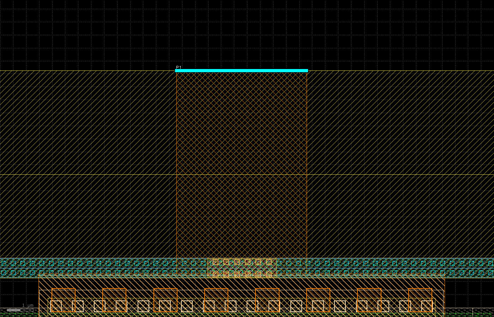

### The port dialog

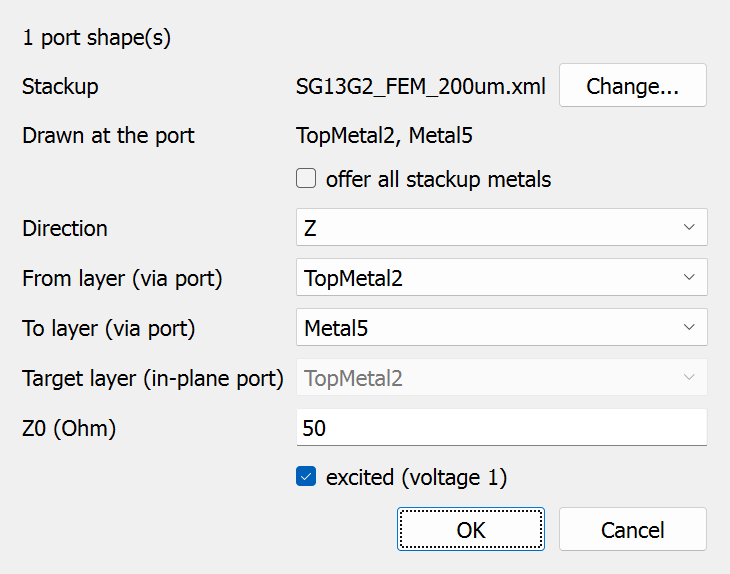

- **Drawn at the port**: the metals found at the port's location. Only these are offered, unless you tick **offer
  all stackup metals**.
- **Direction**: `Z` for a via port, `X` or `Y` for an in-plane port. You do not need `-Z`: the export chooses the
  sign of each via port itself (chapter 10).
- **From layer / To layer** (via port): the signal metal and the reference metal. For the pad: from TopMetal2 (pad)
  to Metal5 (ground plane). A new via port starts from the metal you clicked, down to the next metal below it at
  the port: a via port stops at the first metal it touches. If nothing is below, it goes to the next metal above.
- **Target layer** (in-plane port): the metal with the gap.
- **Z0**: the port impedance, usually 50 Ohm.
- **excited**: whether the simulation feeds signal into this port. Leave it ticked.

To change a port later: select its shape and use **EM > Port Settings...**, or double-click its line in the panel's
port table. A port shape you drew yourself, without settings yet, starts like a new port: from the top metal at the
port down to the next metal below. If only one metal is at the port, the dialog offers all stackup metals.

### Checking your ports

The panel's table lists all ports with their status:

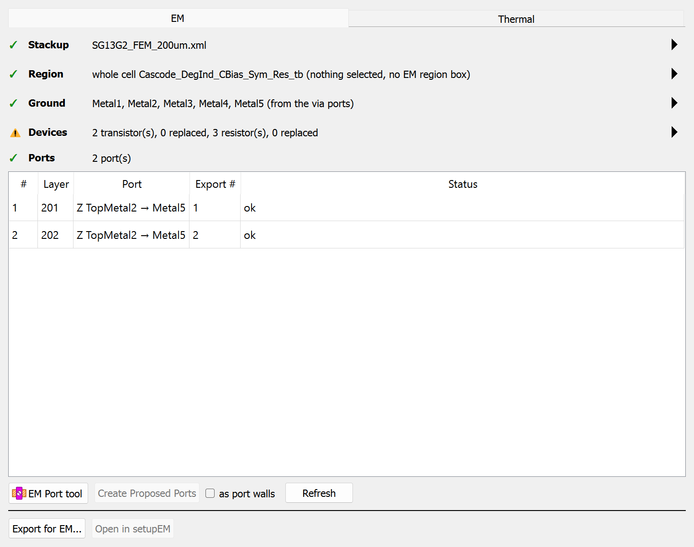

**EM > Port Overview** shows the same as text, checked against the stackup:

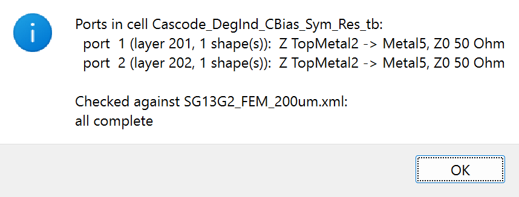

**What can go wrong:**

- A port whose settings are incomplete is exported as a shape, but left out of the simulation. The panel marks it.
- A port that bridges the wrong two conductors measures something else than you intended. Chapter 7 checks the
  most common mistake, a port shorted by the layout.

## Checks: ground and short circuits

> **In this chapter:** the ground net the plug-in finds, and what its checks tell you.
>
> **Why it matters:** a via port measures between a signal metal and ground. If the "ground" end is not connected
> to your ground, or both ends sit on the same net, the port measures a short circuit and the S-parameters are
> worthless. The plug-in traces the metal connections through the vias, so you see this before you simulate.

The plug-in finds the ground net by itself: of the nets your via ports reach, the one most ports reach is ground.
You can also mark ground yourself.

1. Open the details of the **Ground** line.
2. Read the result: the ground metals, how many via ports reach ground, and how many other nets there are.
3. Press **Show in Layout** to see the ground net outlined in green.

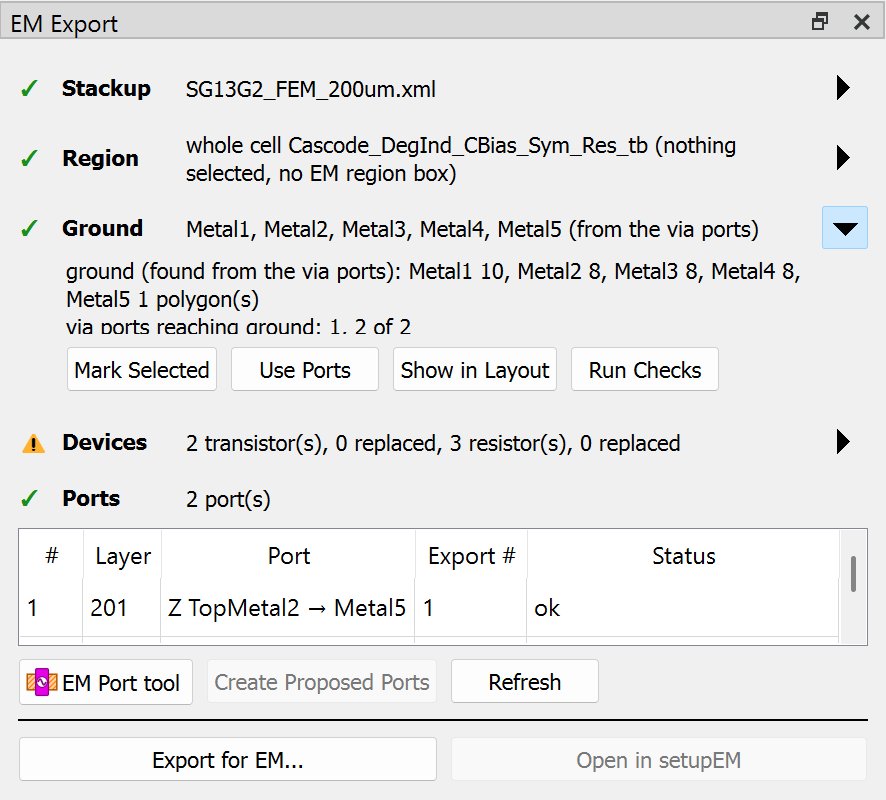

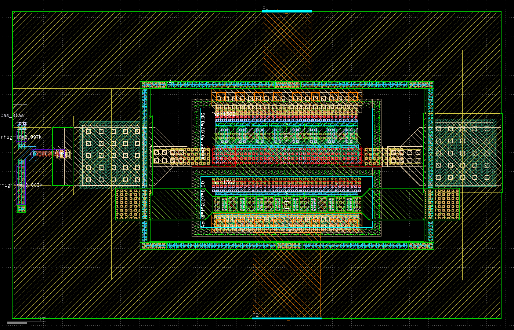

The buttons:

- **Mark Selected**: select one or more metal shapes of your ground first, then press it. Use this if the automatic
  choice is wrong.
- **Use Ports**: forget the marks and use the automatic choice again.
- **Run Checks**: for large regions the checks do not run on every change; press it to run them.

**What can go wrong:**

- "short circuit: both ends of via port(s) ... are on the same net": that port connects two ends that are already
  connected by the layout. Check its from/to layers.
- "no ground: mark a ground shape or add via ports": place the pad ports first, or mark ground.

## Choosing the region to simulate

> **In this chapter:** limiting the EM simulation to the part of the layout you need, and ports at wires you cut.
>
> **Why it matters:** the EM simulation time grows quickly with the size of the region. Simulate the core with its
> wiring, not the whole chip. Where the region cuts through a wire, that wire needs a port, or its end simply floats
> in the simulation.

There are three ways to set the region:

- **Nothing selected, no box:** the whole cell.
- **A selection:** the export offers the selected shapes only, or everything inside their bounding box (chapter
  10).
- **The EM region box:** a box on layer 800/0, saved with your layout. Select the shapes that define the region and
  press **EM > Mark EM Region from Selection** (or the button in the Region details), or draw the box yourself.

In the cascode, the region box is slightly smaller than the cell on the left. It cuts the Cas_Bias wire, the input
of the bias divider. The plug-in sees the cut and proposes a port there:

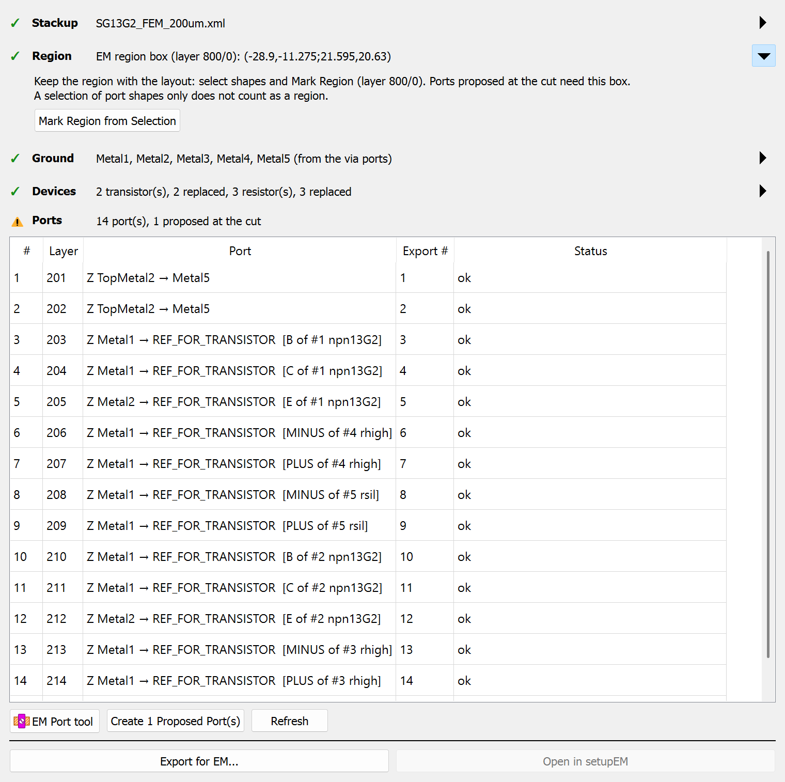

1. Look at the **Ports** line: "1 proposed at the cut".
2. Press **Create Proposed Ports** (below the table). The plug-in places a via port at the cut, from the cut metal
   to the nearest ground metal.

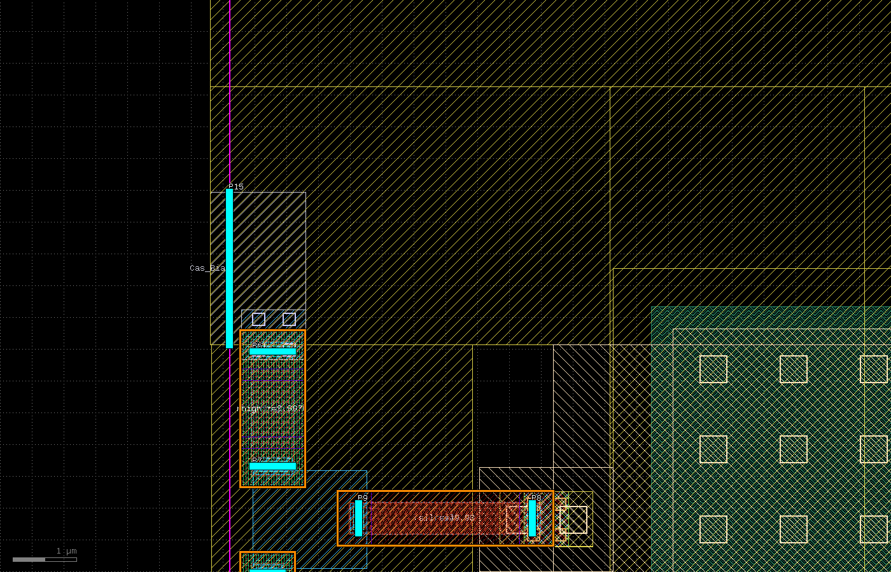

The new port (P15 in the picture) lies on the region's edge, from the Cas_Bias wire on Metal2 to the ground plane on
Metal5. The orange boxes are the transistors' and resistors' REF patches (chapter 9).

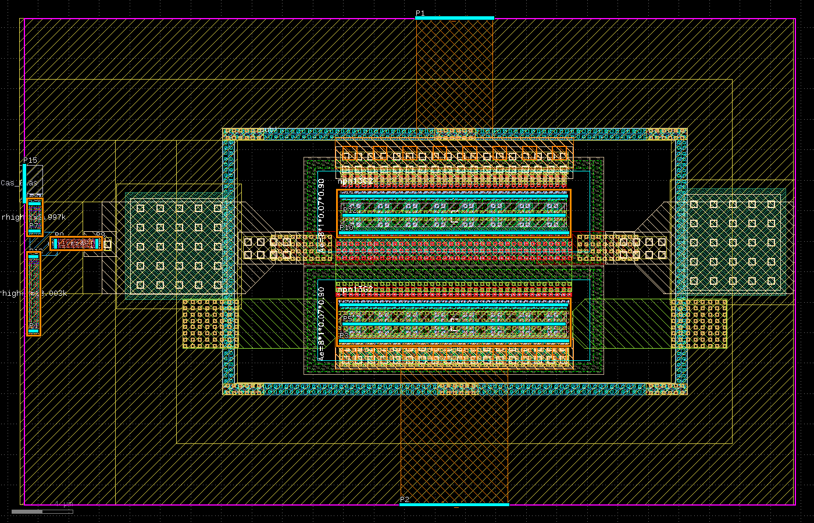

**What can go wrong:** "signal cut, but no ground metal at the cut: add a port by hand": there is no ground metal
near the cut to use as reference. Place that port yourself with the EM Port tool, or choose a region box that does
not cut there.

## Transistors and resistors

> **In this chapter:** replacing the transistors and resistors by ports.
>
> **Why it matters:** the EM simulation cannot simulate a transistor, and the PDK model already contains the
> device's own parasitics up to its pins. So the EM simulation should see the wiring up to the pins, and leave the
> device itself to the circuit simulator. Each transistor is replaced by one port per terminal; in the circuit,
> the PDK model is connected there again (chapter 12).

### What happens

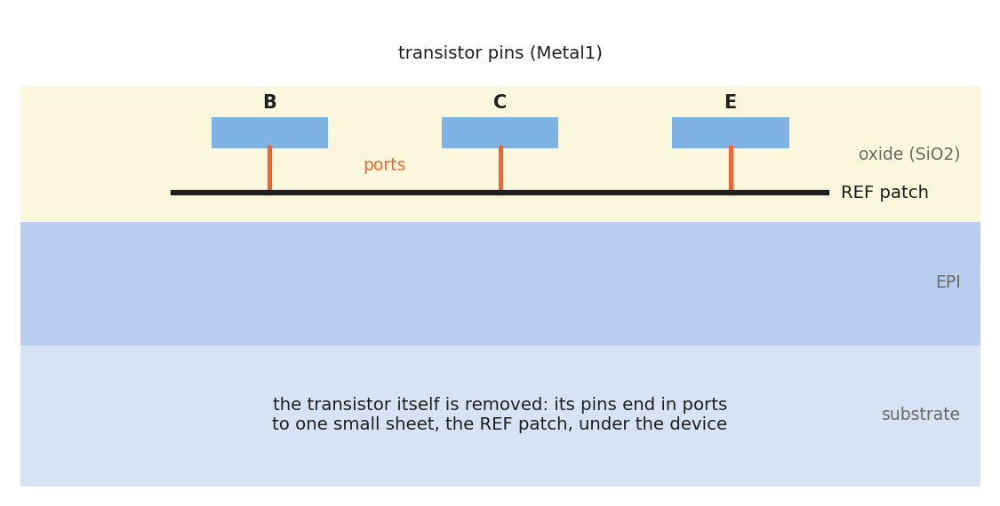

For each transistor, the plug-in:

- places a small sheet under the device, the **REF patch** (layer 300, REF_FOR_TRANSISTOR), just larger than the
  device's pins;
- places one via port per terminal, from the pin metal down to that sheet: base, collector and emitter for an npn,
  drain, gate, source (and bulk tie) for a MOSFET;
- at the export, removes the device's own shapes below the pins (and for the npn the small Metal1 islands under the
  emitter strip), because the PDK model covers them.

Each device has its own REF patch: the devices' ports must not be connected to each other through the patch.

Resistors (rsil, rppd, rhigh) are replaced the same way, with two ports each, and the PDK resistor model takes
their place in the circuit.

### Why resistors should be replaced too

The PDK does not compute a resistor's value from its drawn shape alone. Its pcells and SPICE models add two
corrections:

- **A width offset.** The PDK uses an effective width that differs from the drawn one: rhigh 0.04 µm narrower,
  rsil and rppd 0.01 µm and 0.006 µm wider. This changes the width only, not the length.
- **An end resistance.** Where the silicided contact head meets the resistor body, each end adds a resistance
  per µm of width. It is not part of any drawn sheet.

An unreplaced resistor stays in the EM model as a sheet of the drawn size, with the nominal sheet resistance. The
width offset is missing. Of the end resistance, the EM model has only what its contacts (Cont) contribute.

Both corrections are fixed amounts: a fixed width offset, and a fixed resistance at each end. They do not grow with
the resistor. So the smaller the resistor, the larger their share, and the larger the error: physically small
resistors are affected most. The width offset hurts narrow resistors, the end resistance hurts short ones.

How large is the error? Palace simulations of the PDK cells, as drawn, give:

| Resistor (w × l) | PDK | EM model | Error |
| --- | --- | --- | --- |
| rhigh 0.655 µm × 1.245 µm (cascode, 3 kΩ) | 2997 Ω | 2599 Ω | −13 % |
| rppd 1 µm × 1.665 µm | 500 Ω | 442 Ω | −12 % |
| rhigh 0.5 µm × 4.29 µm (cascode, 13 kΩ) | 13.0 kΩ | 11.7 kΩ | −10 % |
| rhigh 2 µm × 1.325 µm | 999 Ω | 906 Ω | −9 % |
| rsil 0.5 µm × 2.33 µm (cascode, 50 Ω) | 50.0 Ω | 48.9 Ω | −2 % |
| rsil 2 µm × 13.06 µm | 50.0 Ω | 49.9 Ω | −0.2 % |

rhigh and rppd come out about 10 % to 13 % low. rsil is close: its contacts in the EM model happen to make up
for most of its end resistance.

Replaced, the resistor is the PDK model in the circuit: the correct value, with its temperature behaviour. That is
why **include resistors** is ticked by default. If a resistor stays in the EM model, the **Devices** line shows
orange and says so.

### Step by step

1. Open the details of the **Devices** line. A table lists the transistors and resistors found: type, size or
   value, ports and status. Click a row to highlight the device in the layout, double-click to zoom to it. **#**
   is the device's number in Create Circuit's subcircuit (X1, X2, ..., or R3 for a resistor taken from its
   label); the port table names it too, e.g. `[B of #1 npn13G2]`.

   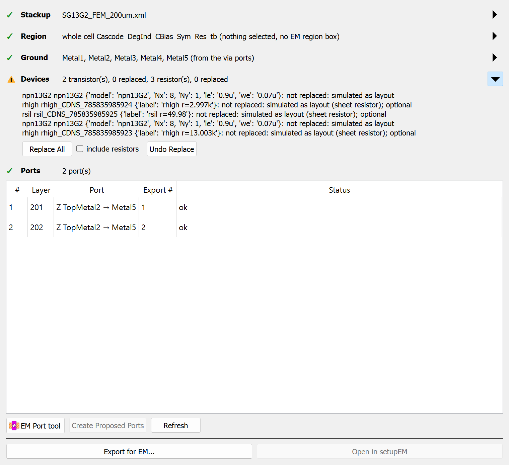

2. Leave **include resistors** ticked (the default). Untick it only if you want the resistors in the EM model, and
   accept that their values come out too low.
3. Press **Replace All**.

   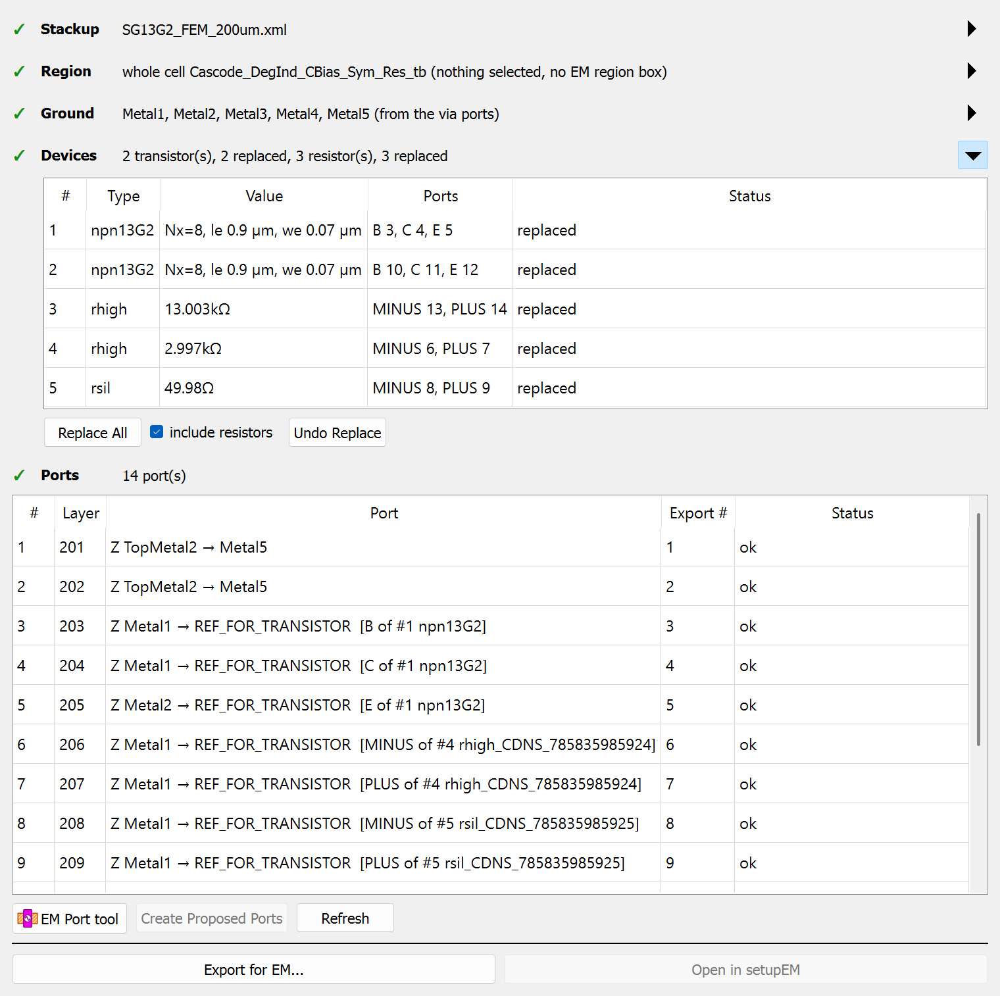

The ports appear in the table. In the layout, each transistor now has its REF patch (orange) and three ports (cyan):

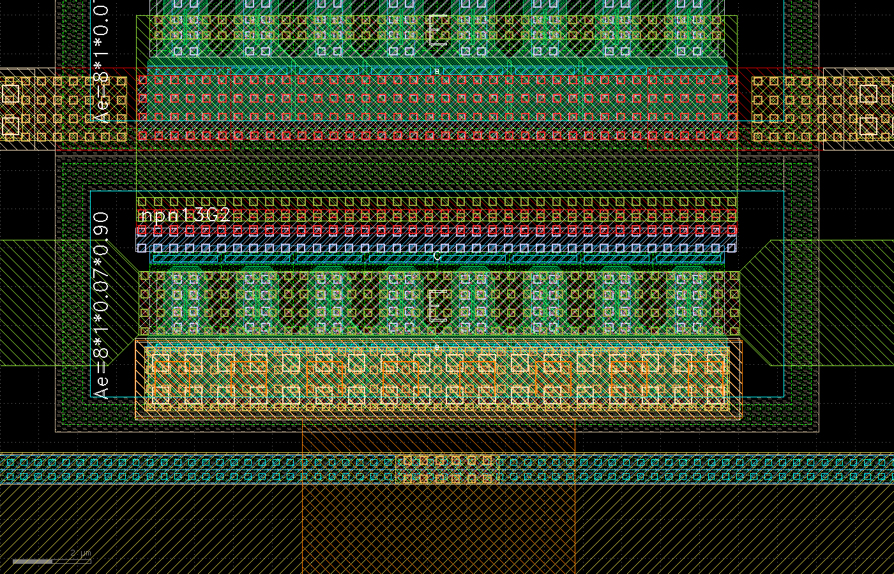

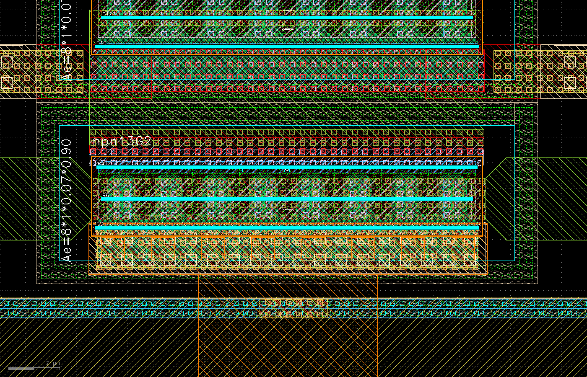

**Undo Replace** removes all patches and ports made by Replace All.

**What can go wrong:**

- "no PDK devices (SG13_dev pcells) in the cell": the IHP PDK is not loaded in KLayout, so the transistors are not
  recognized.
- "pair(s) of REF patches touch": two devices sit so close that their patches overlap and would share one
  reference. The panel names them.
- "terminal(s) not connected": a device terminal has no wiring in the region. Its port would measure an open end.

## Export

> **In this chapter:** writing the layout and the settings for the EM simulation.
>
> **Why it matters:** the export writes a clean, flat layout with only the layers the EM simulation needs, plus the
> ports and a settings file for setupEM. It also writes a port map, which Create Circuit needs later.

When the panel shows green checks (or orange ones you have checked), press **Export for EM...**:

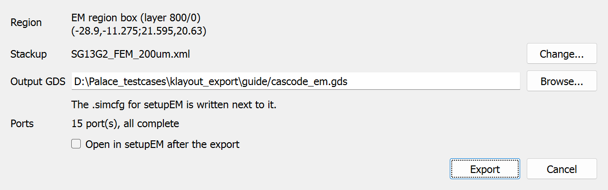

- **Region** and **Stackup**: as in the panel.
- **Output**: where to write the layout. The settings file for setupEM and EMStudio (`.simcfg`) and the port map
  are written next to it, with the same name.
- **Ports**: how many, and whether they are complete. A warning sign marks ports that need attention; the grey
  lines below say which and why.
- **Open in**: starts setupEM (chapter 11) or EMStudio with the result. The choice is remembered.

Press **Export**. You get three files, e.g. for `cascode_em.gds`:

| File | Content |
| --- | --- |
| `cascode_em.gds` | the flat layout: stackup layers and ports only, devices removed below their pins |
| `cascode_em.simcfg` | setupEM's settings: layout, cell, stackup, ports |
| `cascode_em_portmap.json` | which port is what: pad, or which terminal of which device, and each port's net |

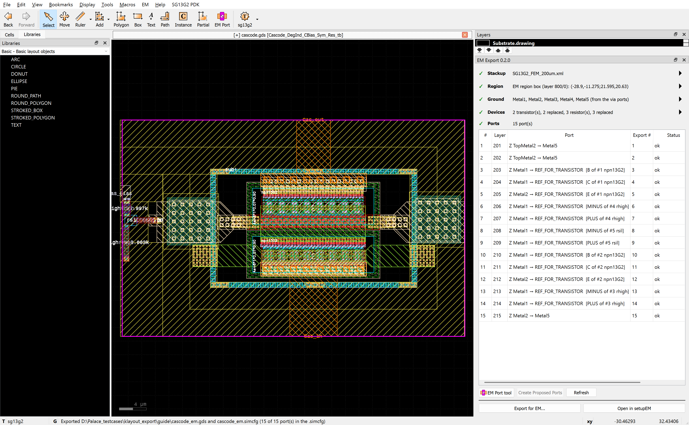

Good to know:

- **Port numbers:** the export numbers the ports 1, 2, 3, ... without gaps. The port map links them back to the
  layout's ports. The panel's table shows both numbers.
- **Port direction:** the export sets each via port's direction (`Z` or `-Z`) so that all via ports have their
  signal metal on the same end. That is why port 15 (Metal2 below its ground on Metal5) comes out as `-Z` in setupEM.
- **Exporting again** keeps everything you set in setupEM (frequencies, mesh, ...) and only updates layout, stackup
  and ports.
- **Open in setupEM** (or **Open in EMStudio**) in the panel opens the last export again, without exporting. The
  other program is in the EM menu.

**What can go wrong:** you export again after a layout change, but run the old model script (`.py`) from setupEM.
The script reads the new layout under the same file name, with its old port list. Port numbers can shift when a
port is added or removed, so the old script's port 3 may now be another port, and the S-parameters no longer
belong to the port map. The export checks the model scripts next to the layout (and in setupEM's output folder)
and warns about each one whose ports differ. Then open the export in setupEM: it asks whether to **Continue with
the script**. Choose that, and setupEM takes the ports, layout file, stackup and cell from the export and keeps your
other settings (frequencies, mesh, ...) and any code you added to the script. Create Model writes the script. An
EMStudio model next to the layout is updated by EMStudio itself when the export opens it there, see below.

## setupEM and the Palace run

> **In this chapter:** the EM simulation settings, and the one setting that matters most for the circuit.
>
> **Why it matters:** for a circuit with bias, the EM result needs a good value at 0 Hz: the DC connections of your
> wiring. gds2palace provides that only if the frequency sweep starts at 0.

setupEM opens with your exported model. The **Input Files** tab shows the layout, cell and stackup from the export:

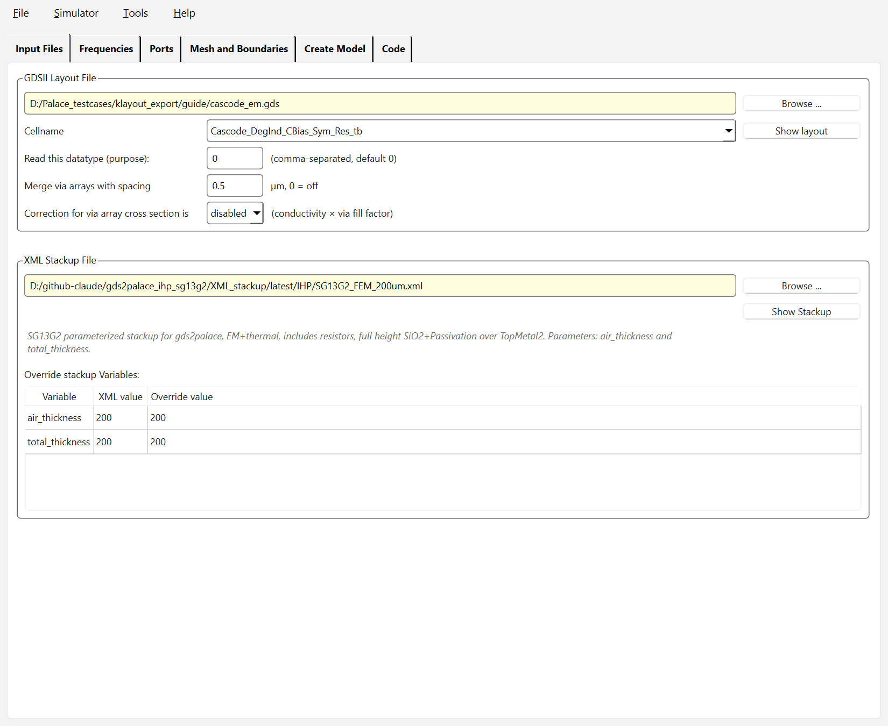

The **Ports** tab shows the exported ports:

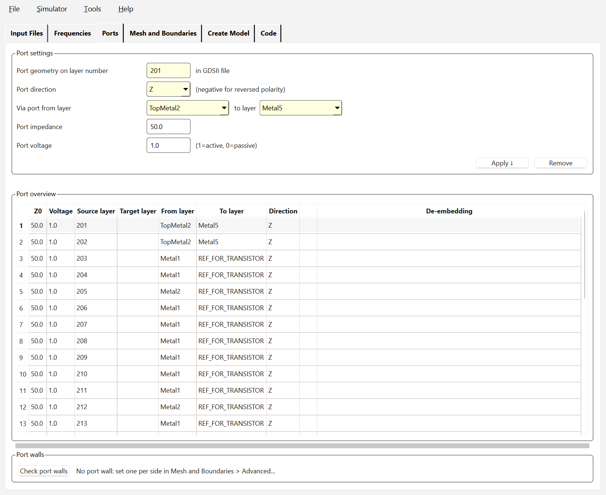

### Frequencies: start at 0

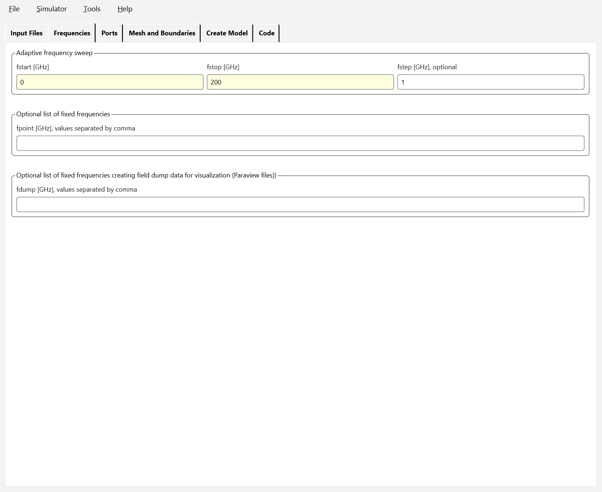

1. Set **fstart** to **0**.
2. Set **fstop** to the highest frequency you need (200 GHz for the cascode), and **fstep** (1 GHz).

With fstart = 0, gds2palace simulates 10 MHz and 20 MHz in addition, and writes a second result file,
`<model>_dc.sNp`, with a 0 Hz point extrapolated from them. That is the file for chapter 12.

### Mesh and model

Mesh and boundaries are explained in the setupEM and gds2palace documentation. For a first run, the defaults work.

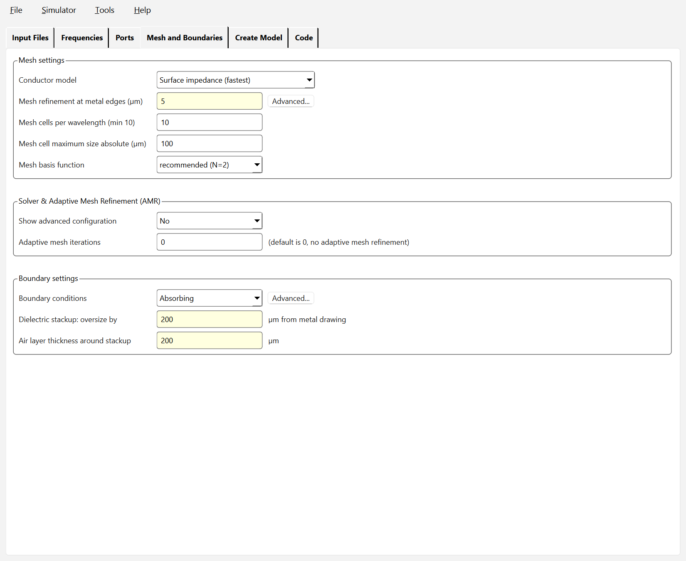

On the **Create Model** tab, create the Palace model, then run Palace (on Linux, e.g. with the `run_palace` script
of gds2palace). After the run, `combine_snp` writes the S-parameter files, for the cascode `<model>.s15p` and
`<model>_dc.s15p`.

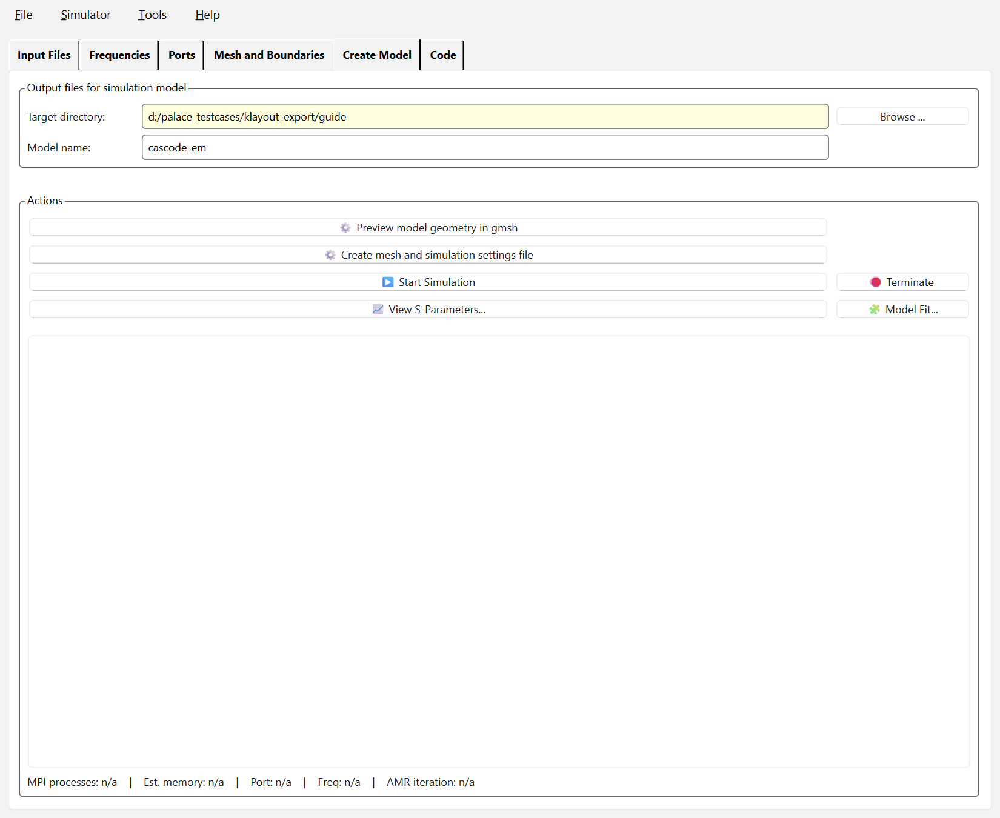

**What can go wrong:** a sweep that starts at 1 GHz or higher gives a 0 Hz point that is extrapolated too far. Its
DC paths are not accurate enough for a bias network with kOhm resistors. Create Circuit then protects the bias with
DC blocks (chapter 12), but the cleaner way is to start at 0.

### EMStudio instead of setupEM

EMStudio does the same job in one window: model settings, the simulation run and the results. Choose **EMStudio**
next to **Open in**. EMStudio then reads the export the way setupEM does, and asks whether the model
is for **Palace** or **OpenEMS**.

- **The first time**, EMStudio makes a new model for the simulator you chose: layout, cell, stackup and ports. Set
  the frequencies there, starting at **0 GHz** as above, and save. The model is saved as `<name>.py` next to the
  layout, e.g. `cascode_em.py`.
- **After a layout change**, export again. EMStudio finds `cascode_em.py` and updates only its ports, layout,
  stackup and cell. Your frequencies and mesh stay. Save to keep the update.
- **The stackup always comes from the export.** A stackup you picked in EMStudio is replaced on the next export, so
  choose it in the export dialog.
- **The first import fixes the simulator.** EMStudio asks only once. For the other simulator, rename or delete
  `cascode_em.py` and export again; you get a new model and set its frequencies again.
- **Keep the model where EMStudio put it.** If you save it elsewhere or under another name, the next export does not
  find it and makes a new model.
- The port directions arrive as exported, `-Z` included, so the circuit wrapper fits.

**For OpenEMS**, prepare the export differently:

- **Stackup:** choose an OpenEMS stackup (from gds2openEMS), never a Palace one. They model some layers, e.g. the
  MIM dielectric, differently.
- **Devices:** don't replace them. Device ports end on a reference layer that only the Palace stackups have; for
  OpenEMS, simulate the layout without device replacement.

Nothing stops you from mixing these up, so check both before the export.

You need an EMStudio whose **File > Import setupEM Config** asks for Palace or OpenEMS (IHP-GmbH/EMStudio PR #53).
An older build has the menu too, but imports every export as a Palace model. If the plug-in cannot find EMStudio,
it asks once where the program is.

## Back to the circuit: Create Circuit

> **In this chapter:** turning the EM result into a circuit with your transistors, for your circuit simulator.
>
> **Why it matters:** this is where the EM work pays off: you simulate the amplifier with its real wiring, with the
> PDK transistor models and their bias.

### Creating the circuit

**EM > Create Circuit (EM Result with Devices)...**:

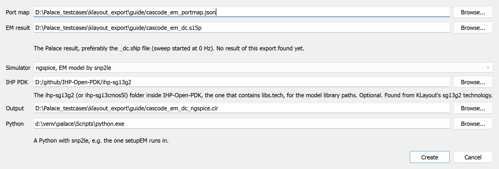

1. **Port map**: the export's `_portmap.json` (the last export of this layout is filled in).
2. **EM result**: the Palace result, preferably the `_dc.sNp` file.
3. **Simulator**: see below.
4. **IHP PDK** (optional): the `ihp-sg13g2` or `ihp-sg13cmos5l` folder of IHP-Open-PDK. Then the model library lines in the circuit
   file point to it.
5. **Output**: the circuit file (proposed from the result's name).
6. **Python**: a Python with snp2le, by default the one of the setupEM environment.
7. Press **Create**.

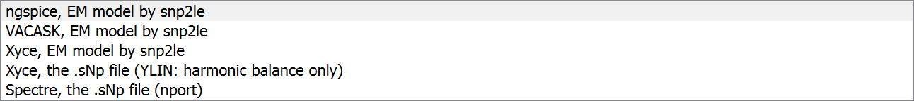

| Choice | The EM result goes in as | Use it for |
| --- | --- | --- |
| ngspice, EM model by snp2le | an equivalent circuit (fitted by snp2le) | DC, AC, transient, noise |
| VACASK, EM model by snp2le | an equivalent circuit (VACASK format) | as ngspice, plus harmonic balance |
| Xyce, EM model by snp2le | an equivalent circuit | DC, AC, transient, harmonic balance |
| Xyce, the .sNp file | the S-parameter file itself (YLIN element) | harmonic balance only: Xyce treats it as open in AC and DC |
| Spectre, the .sNp file | the S-parameter file itself (nport element) | all analyses; add your PDK's model includes |

The result shows what was written:

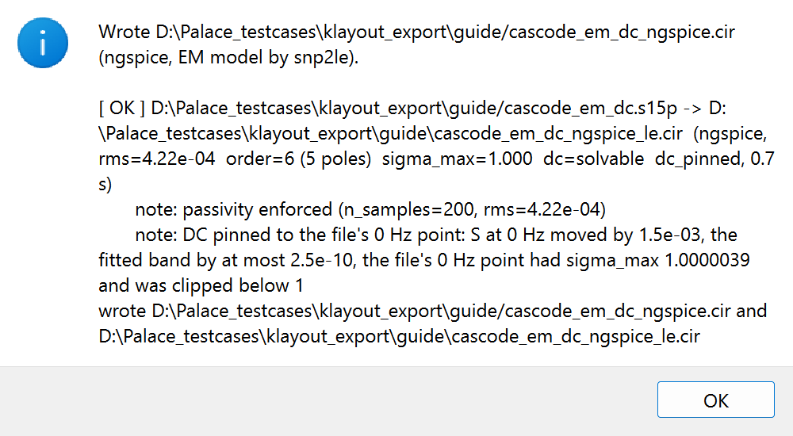

For the snp2le choices you get two files: the circuit (`..._ngspice.cir`) and the EM model's equivalent circuit
(`..._le.cir`), which the circuit includes.

### What is in the circuit

The circuit is one subcircuit. Its pins are the ports that belong to no device: the pads and the bias input. Inside:

- **the EM model**, with one pin per port;
- **the PDK transistor models**, each terminal connected directly to its port's pin (npn13G2 with Nx, le, we from
  your layout);
- **the resistors**: PDK models, or ideal resistors of the label value for static resistor cells;
- **1 mH inductors** between the ports of each net, and to ground for the ground net.

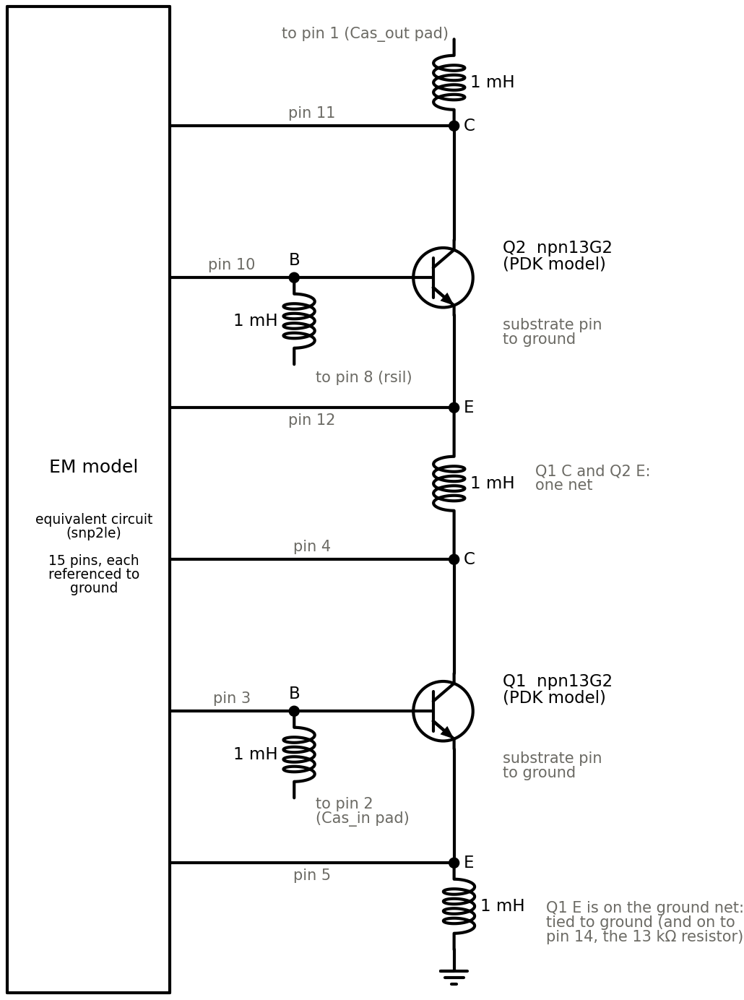

**Why the 1 mH inductors?** A port measures a voltage between a device pin and its REF patch. The patch has no DC
connection to anything, so the EM result alone does not tell the circuit simulator at which DC potential a
transistor sits. The inductors tie each terminal to the rest of its net: at DC they are shorts and carry the bias, at
RF (GHz) they are open and leave the signal to the EM model. The port map tells which ports are on the same net.

The full circuit with the testbench, the layout's wiring drawn as dashed lines inside the EM model:

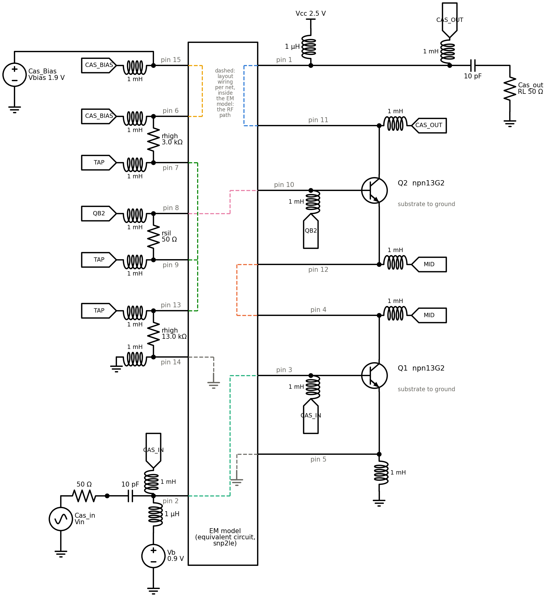

### Using it in your testbench

ngspice example (`--pdk` given, so the model library lines are active):

```spice
.include cascode_em_dc_ngspice.cir
Vcc  vcc 0 2.5
Lc   vcc port1 1u          ; bias tee at the output
Cout port1 out 10p
Rl   out 0 50
Vb   vb 0 0.9
Lb   vb port2 1u           ; bias tee at the input
Vin  src 0 dc 0 ac 1
Rs   src in 50
Cin  in port2 10p
Vbias port15 0 1.9         ; Cas_Bias
X1 port1 port2 port15 cascode_em_dc_ngspice
```

- **VACASK:** include the `.inc` file. VACASK finds the PDK's models through the PDK's `.vacaskrc.toml`: copy it next
  to your testbench.
- **Spectre:** the PDK include lines are written as comments: replace them with the includes of your SG13G2 PDK
  installation.

**What can go wrong:**

- "no 0 Hz point in the .sNp: the EM model is connected through 1 uF DC blocks": your result has no DC point
  (chapter 11). The circuit still works, the DC blocks keep the EM model out of the bias.
- "the port map has no signal layers (older export)": export again with the current plug-in.
- snp2le not found: choose the Python of the environment where snp2le is installed.

## The cascode example: results

> **In this chapter:** what the flow gives for the example, and how much each modelling choice matters.
>
> **Why it matters:** it shows what to expect, and which numbers to check in your own design.

The exported cascode, with all 15 ports:

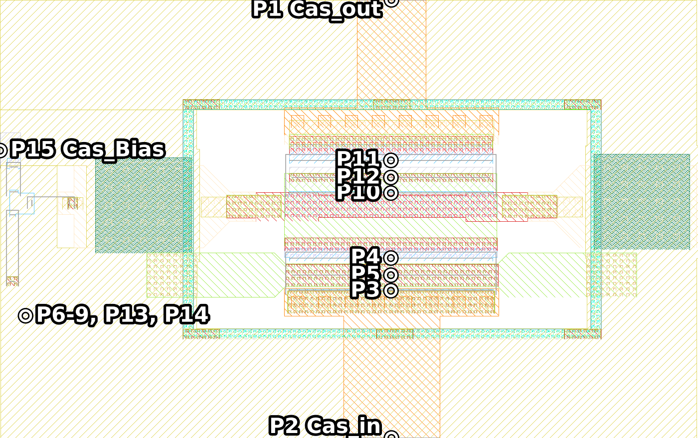

**The EM model as a circuit:** snp2le's equivalent circuit reproduces the Palace result within 0.003 in S, for all
225 S-parameters from 1 to 200 GHz:

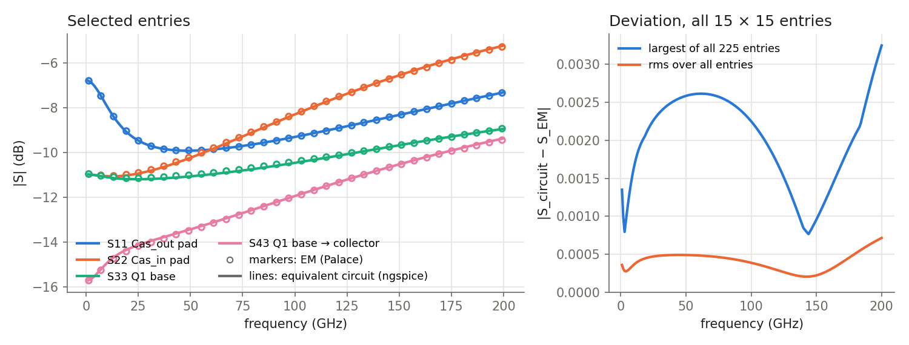

**The amplifier:** with Vcc = 2.5 V, Vb = 0.9 V and Cas_Bias = 1.9 V, the cascode draws Icc = 11.3 mA, and S21 is
21.6 dB at 10 GHz, 7.9 dB at 100 GHz and −1.0 dB at 200 GHz. The core is unmatched: it has no matching networks.

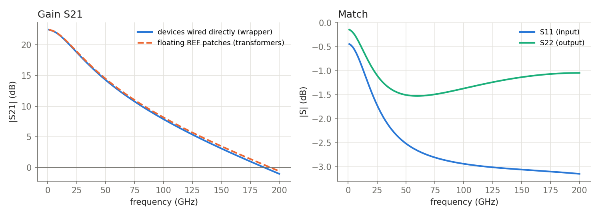

**The simulators agree:** VACASK gives the same result as ngspice. Xyce gives the same operating point, and S21 0.5 dB
higher at 100 GHz, which comes from Xyce's version of the transistor model, not from the EM model.

**The cost of the simple wiring:** connecting the transistors directly to the EM model ties their REF patches to
ground, which adds a few fF. In the cascode that lowers S21 by 0.06 dB at 10 GHz and 0.4 dB at 200 GHz.

## Troubleshooting

> **In this chapter:** the messages of the plug-in, what they mean, and what to do.

| Message | Meaning | What to do |
| --- | --- | --- |
| Stackup: none chosen yet | no stackup for this layout | choose one (chapter 5) |
| Ground / Devices: needs a stackup | nothing can be checked without a stackup | choose one |
| no ground: mark a ground shape or add via ports | no via port reaches metal yet | place the pad ports, or mark ground (chapter 7) |
| short circuit: both ends of via port(s) ... on the same net | the port is shorted by the layout | check the port's from/to layers |
| the marked ground is N separate pieces in the region | the marked ground pieces connect only outside the region | enlarge the region, or check the marks |
| large region, not checked: Run Checks in the details | checks are skipped for speed | press Run Checks |
| N cut without ground | the region box cuts signal wires with no ground metal nearby | place those ports by hand |
| no PDK devices (SG13_dev pcells) in the cell | transistors not recognized | load the IHP PDK in KLayout |
| N pair(s) of REF patches touch | two devices would share a reference | keep devices apart, or check the layout |
| N terminal(s) not connected | a device terminal has no wiring in the region | enlarge the region, or check the layout |
| resistor "not replaced: EM gives R too low" | a resistor stays in the EM model as a sheet of drawn size, without the PDK's width offset and contact end resistance (about 10 % low) | tick include resistors and press Replace All (chapter 9) |
| port N ... not simulated (incomplete) | port settings missing | set them (EM > Port Settings...) |
| layer '...' is not a metal of the stackup | a port uses a layer the stackup does not know | choose another layer in the port dialog |
| ... is not drawn at the port | the port's from/to layer has no metal at the port | check the port position and layers |
| All port layers 201..299 are used | no free port layer left | remove unused ports |
| This layout has not been exported yet | Open in setupEM or EMStudio needs an export first | press Export for EM... |
| EMStudio ended at once (exit code 1): this EMStudio cannot open a .simcfg | your EMStudio has no .simcfg import yet (it ends on a .simcfg on its command line) | open the export with setupEM, or use an EMStudio with File > Import setupEM Config |
| no 0 Hz point in the .sNp | the EM result has no DC point | start the sweep at 0 Hz (chapter 11) |

## Reference

### Layers used by the plug-in

| Layer | Use |
| --- | --- |
| 201 ... 299 | ports: port number = layer − 200 (layers used by the stackup itself, e.g. SUBGND, are skipped) |
| 300 | REF_FOR_TRANSISTOR: the transistors' and resistors' REF patches |
| 800/0 | the EM region box |

### Stored in the layout

Saving the layout keeps its EM setup. The export copies none of this into `<name>_em.gds`.

| What | Where |
| --- | --- |
| Port settings (metals, direction, Z0) | GDS property 200 on each port shape |
| Boundary port mark | GDS property 201 on ports made by Create Proposed Ports |
| Replaced device | GDS property 202 on the device's REF patch and ports |
| Stackup, last export, ground marks | layout meta info `klayout_em_export.stackup`, `.output`, `.ground` |

**Your original file is kept.** The first time the plug-in changes a layout that has none of its data yet (you
place a port, choose a stackup, mark ground, replace devices, ...), it copies the layout file as it is on disk to
`<name>.gds.bak`, next to it. The status bar says so. An existing `.bak` is never replaced. Saving the layout later
writes the EM setup into `<name>.gds`; the `.bak` is your original, without any of it. KLayout itself can keep
backups of every save as well: **File > Setup > Application > General**, number of backup files.

KLayout saves meta info in an extra cell `$$$CONTEXT_INFO$$$` in the GDS file. KLayout hides it, but other GDS
tools may show it as an empty top cell. (KLayout writes this cell anyway for a layout with PCells.)

**Before you pass the layout on**, e.g. for tape-out, remove the EM setup:

1. Delete the shapes on the port layers, on layer 300 and on 800/0 (see the layer table above). A layout
   converted with Fill Density Holes and Merge Metal must not be passed on at all: use the original.
2. Remove the meta info in the Python console of the macro editor (**Macros > Macro Development**, F5), then
   save:

   ```python
   import pya
   ly = pya.CellView.active().layout()
   for key in ("klayout_em_export.stackup", "klayout_em_export.output", "klayout_em_export.ground"):
       ly.remove_meta_info(key)
   ```

The plug-in also keeps a copy of the stackup, the last export and the ground marks in `~/.klayout_em_export.json`.
It uses that copy only when the layout has none of its own.

### Files

| File | Written by | Content |
| --- | --- | --- |
| `<name>_em.gds` | Export | flat layout for the EM simulation |
| `<name>_em.simcfg` | Export | settings for setupEM and EMStudio |
| `<name>_em_portmap.json` | Export | ports: layout number, device and terminal, net |
| `<model>.sNp`, `<model>_dc.sNp` | gds2palace after Palace | S-parameters, without and with the 0 Hz point |
| `..._<simulator>.cir` / `.inc` / `.scs` | Create Circuit | the circuit |
| `..._le.cir` / `_le.inc` | Create Circuit (snp2le) | the EM model's equivalent circuit |
| `~/.klayout_em_export.json` | the plug-in | remembered choices: stackup, setupEM and EMStudio, Create Circuit settings |

### Limits

- Only the IHP SG13G2 PDK cells are recognized as devices (npn13G2 family, nmos/pmos and their HV and RF variants,
  rsil, rppd, rhigh).
- The 1 mH ties are ideal: the wiring's DC resistance is not in the bias (in the cascode it would lower Icc by about
  6 %).
- Resistors from static cells (no PDK parameters) become ideal resistors of their label value: no temperature
  behaviour, no parasitics. A static npn cell (e.g. `npn13G2$1` in a layout saved without pcell context, as some fill
  tools write it) gets its size from its `Ae=Nx*Ny*we*le` label; without that label it is not replaced.
- Resistors left in the EM model (not replaced) come out too low: the sheet has the drawn size, without the PDK's
  width offset and contact end resistance. rhigh and rppd are about 10 % to 13 % low, rsil up to about 2 %
  (chapter 9). A resistor of several segments cannot be replaced yet.
- The REF patch adds a few fF per transistor when the device is wired directly (chapter 13).
