# Examples

Two layouts to try the plug-in on, both in IHP SG13G2:

- [**cascode**](#cascode-the-example-of-the-users-guide): the cascode core of the user's guide, from the layout to
  the circuit, with its EM result so that you can try Create Circuit without running Palace.
- [**split_region**](#split_region-two-inductors-split-at-the-feed): two inductors in series, in a region split into
  two pieces that setupEM simulates one by one and joins, with port walls and reference results.

The layouts store no stackup: choose `SG13G2_FEM_200um.xml` from gds2palace (`XML_stackup/latest/IHP`, or the one
installed with the gds2palace package) in the EM panel.

## cascode: the example of the user's guide

`cascode/cascode.gds` is the cascode core the [user's guide](../doc/userguide/klayout_em_export_userguide.md)
follows from start to end: two npn13G2 transistors stacked in the middle, a bias divider of three resistors at the
left edge, and two RF pads, Cas_in at the bottom and Cas_out at the top.

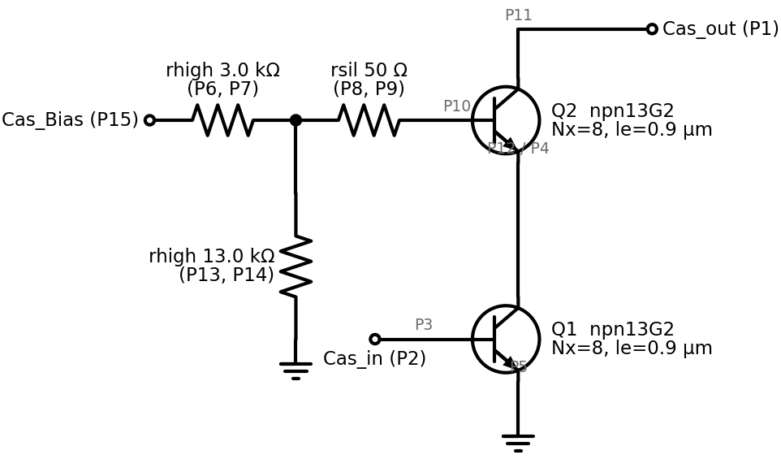

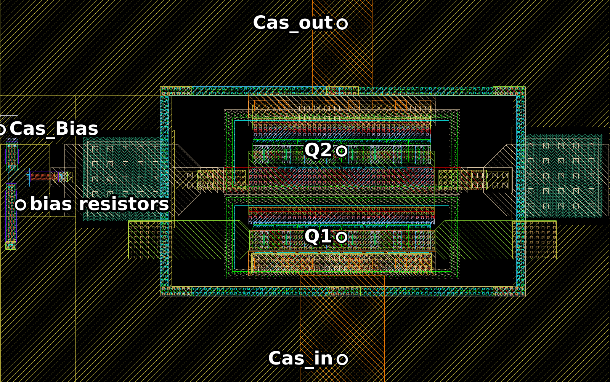

Open it in KLayout and follow the guide. In short:

1. **Stackup** in the EM panel: `SG13G2_FEM_200um.xml`.
2. **Ports** at the two pads with the EM Port tool (chapter 6).
3. **Ground**: check that the ground plane is one net (chapter 7).
4. **Region**: an EM region box around the core; Create Proposed Ports adds the port where it cuts the bias wire
   (chapter 8).
5. **Devices**: Replace All replaces the two transistors and the three resistors by ports at their pins
   (chapter 9).
6. **Export for EM...** writes the layout, the settings file and the port map, and opens setupEM (chapters 10, 11).

When every step has its green check, the layout is ready for the export:

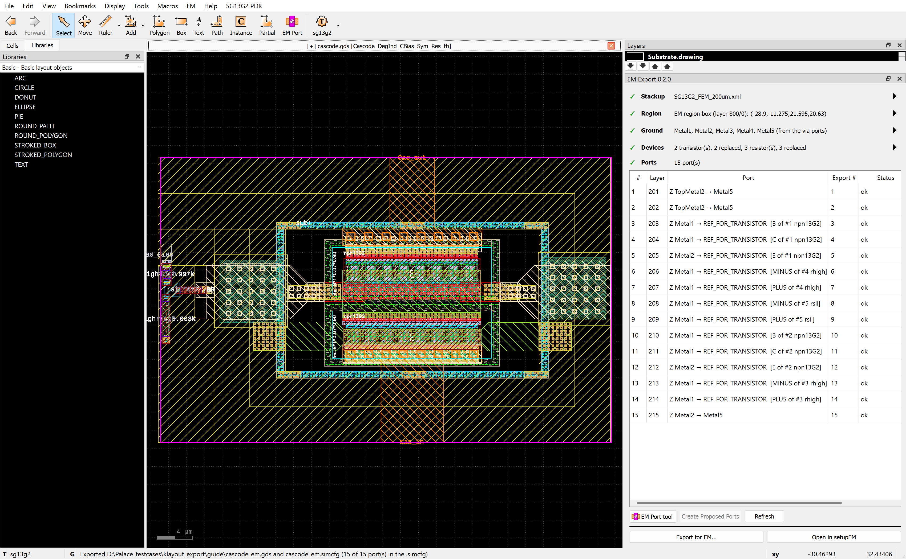

The export has 15 ports: the two RF pads (P1, P2), the bias wire at the region edge (P15), and one port per
terminal of each replaced device, P3 to P5 and P10 to P12 for the two transistors, P6 to P9, P13 and P14 for the
resistors.

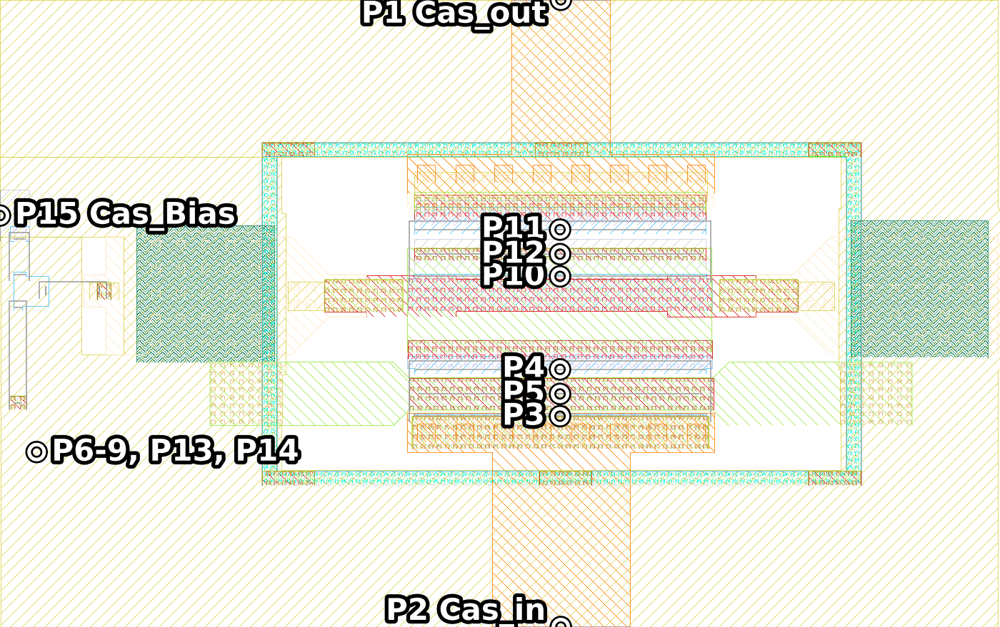

### Try Create Circuit with the supplied result

`cascode/em_result/` holds the result of the guide's export, so that you can try the last step without running
Palace:

| File | Content |
| --- | --- |
| `cascode_em_portmap.json` | the port map of the guide's export: for each of the 15 ports, the pad or device terminal and its net |
| `cascode_em_dc.s15p` | its Palace result, 0 to 200 GHz with the 0 Hz point; how it was simulated: [cascode test report](../doc/test_cascode_wrapper/README.md) |

In **EM > Create Circuit from EM Result...**, choose these two files as the port map and the EM result, then the
simulator and the folder for the circuit:

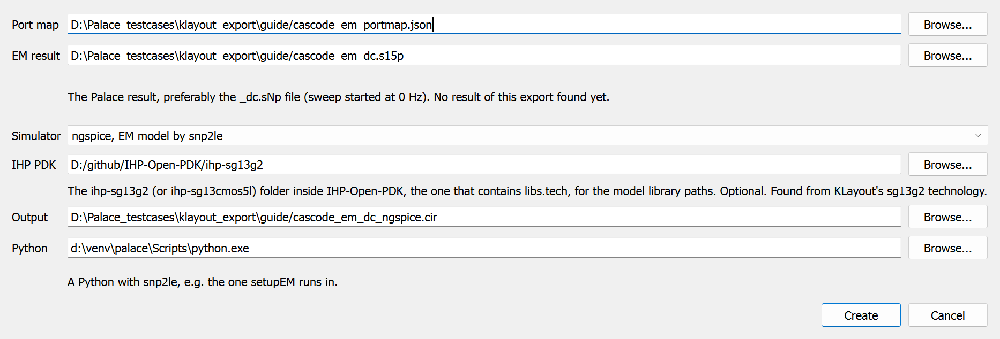

Create Circuit puts the PDK transistors and resistors back at their ports and writes the circuit for your
testbench, here for ngspice with snp2le's equivalent circuit of the EM model:

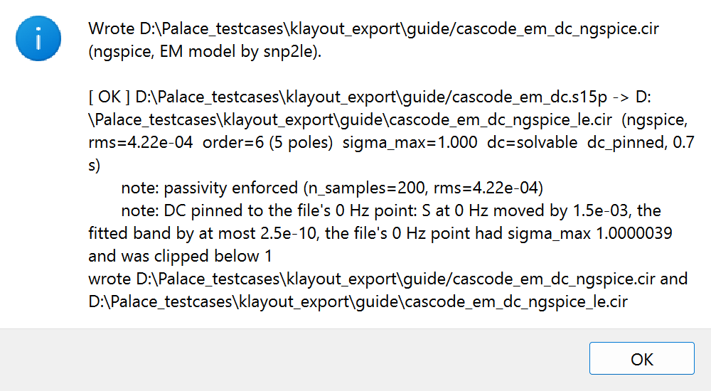

The two files fit only an export whose ports are numbered as in the guide; after other changes, use your own export
and result. With the bias of the guide (Vcc = 2.5 V, Vb = 0.9 V, Cas_Bias = 1.9 V), the circuit gives this gain and
match (chapter 13 of the guide):

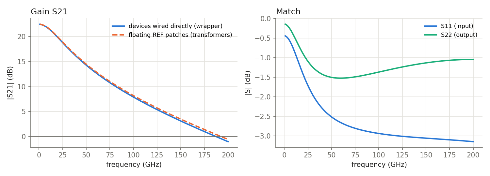

## split_region: two inductors, split at the feed

A large region takes long to simulate, and every change means simulating all of it again. Split into pieces, each
piece is simulated as its own model, and setupEM joins the results into one result of the whole region. Where two
pieces meet, each line that crosses the cut gets a port wall port in each piece, calibrated with its reference
plane on the cut, so the two results connect at the same plane.

`split_region/two_inductors_split.gds`: two single-turn inductors (TopMetal2, 8 µm wide, 50 µm centre radius) in
series on a TopMetal2 microstrip, over a Metal1 plate with an octagonal cutout under each inductor. The region is
split into two pieces, p1 and p2, in the middle of the 300 µm of feed between the two cutouts. Everything is
already set up: the two region boxes, the ground marks and the four ports.

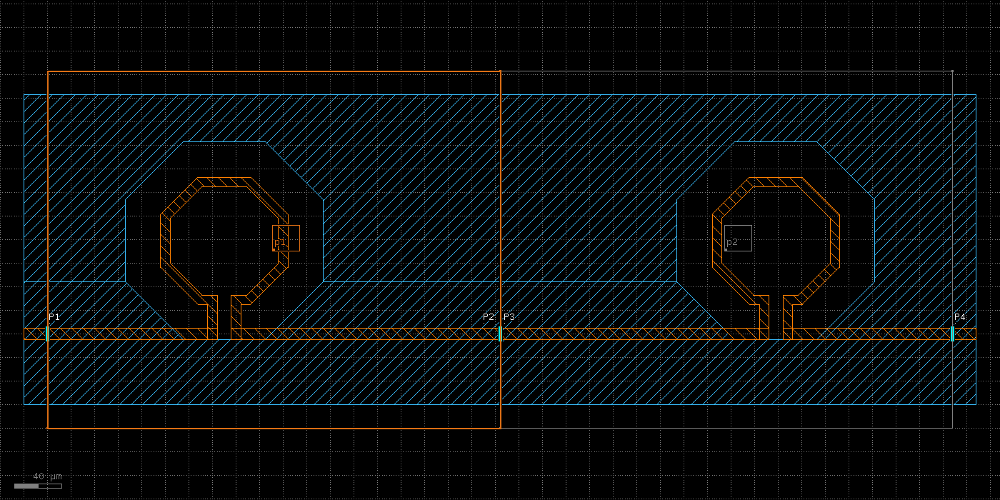

- **The pieces** are two boxes on layer 800/0, named p1 and p2. They share an edge, the cut, which runs across the
  feed line and the plate, away from both inductors.
- **The ports** are port wall ports on the TopMetal2 line: P1 and P4 at the two ends of the region, P2 and P3 at
  the cut, one in each piece. The ground at the cut is the Metal1 plate under the line.

At the cut, P2 (piece p1) and P3 (piece p2) lie on the same place, on the edge the two boxes share:

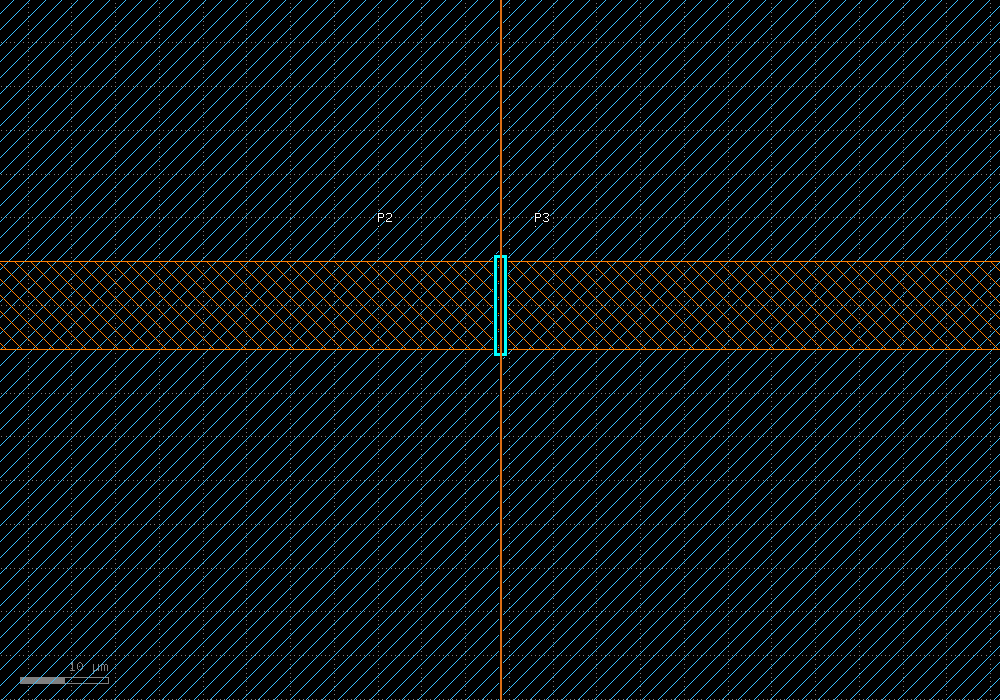

**Ground of** in the panel picks the piece whose ground the Ground line shows; for p1, the part of the plate in p1 is
outlined in green:

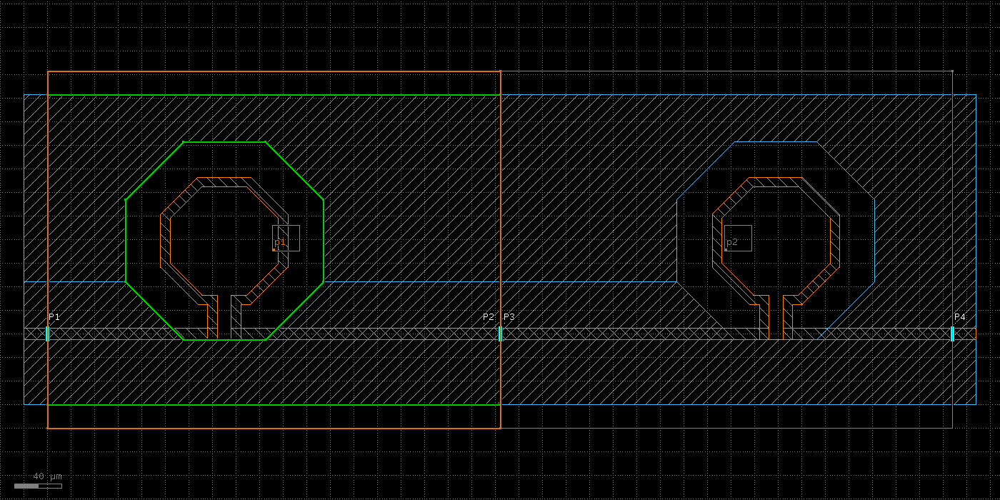

### Steps

1. **Open the layout and choose the stackup.** The Region line of the EM panel shows the two pieces. In the port
   table, **Export #** gives each port's number in its piece and in the joined result: P1 is port 1 of p1 and of
   the joined result, P4 port 2 of p2 and port 2 of the joined result, P2 and P3 are the ports at the cut that the
   join connects.

   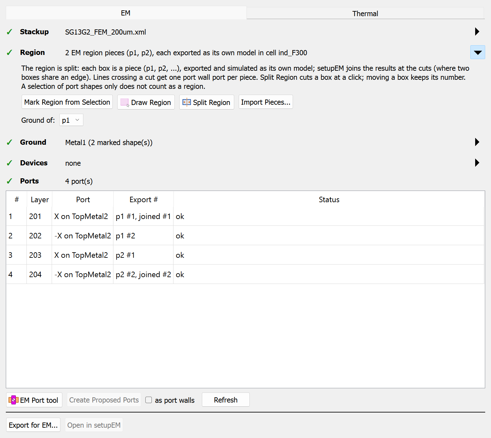

2. **Export for EM...** writes the whole region as usual and each piece into `<name>_pieces/` (p1, p2, and `full`,
   the whole region as one model, to check the join).

   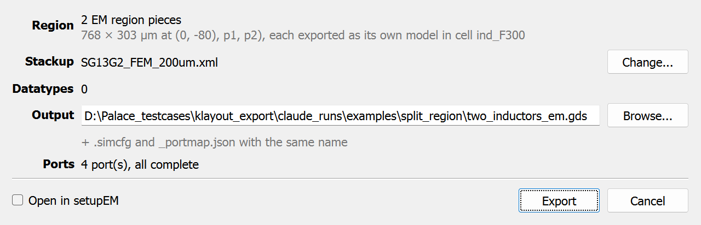

3. **Open the `.simcfg` in setupEM.** The frequencies, the mesh, the solver and the boundaries are those of the
   whole region, the same for all pieces; the Mesh and Boundaries tab says which sides of a piece the split sets
   (here for p1: its right side is a port wall at the cut to p2). To compare with the reference results below, set
   0 to 60 GHz in 1 GHz steps and a refined cell size of 5 µm.

   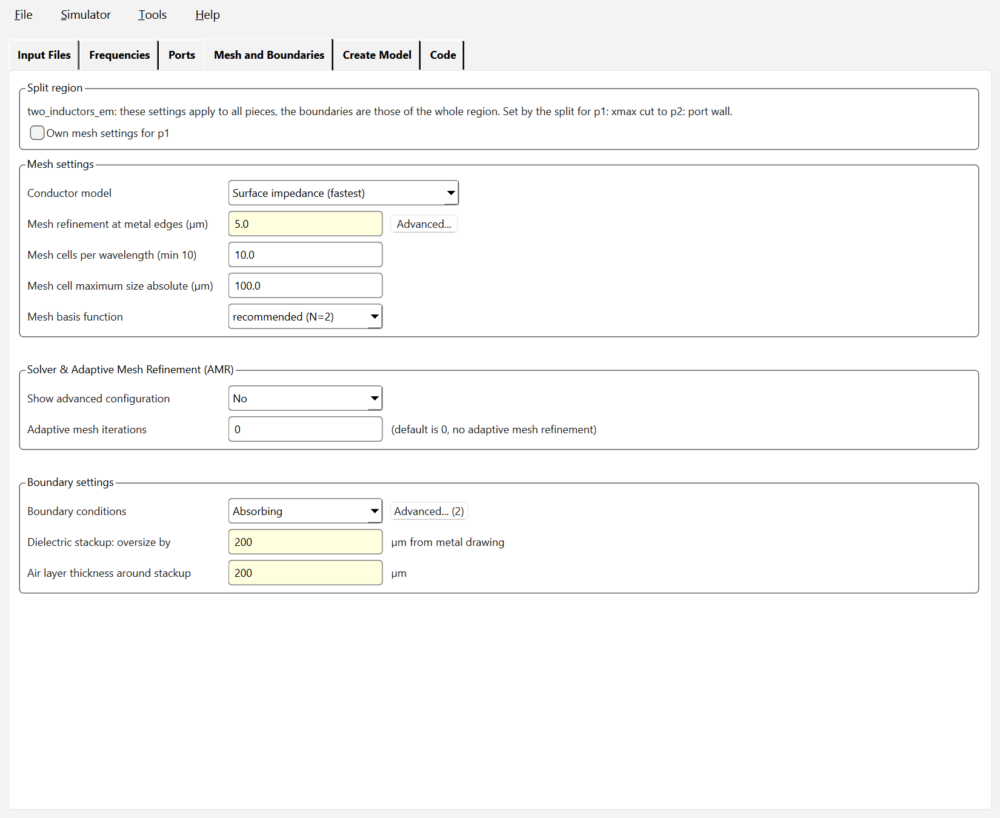

4. **Start Simulation** on the Create Model tab simulates the ticked pieces and joins their results into one 2-port,
   written where a single model would write its result. Tick **full (check)** once to simulate the whole region as
   one model too, and compare. After a change in one piece, only that piece is simulated again; **Run unchanged
   pieces too** forces all.

   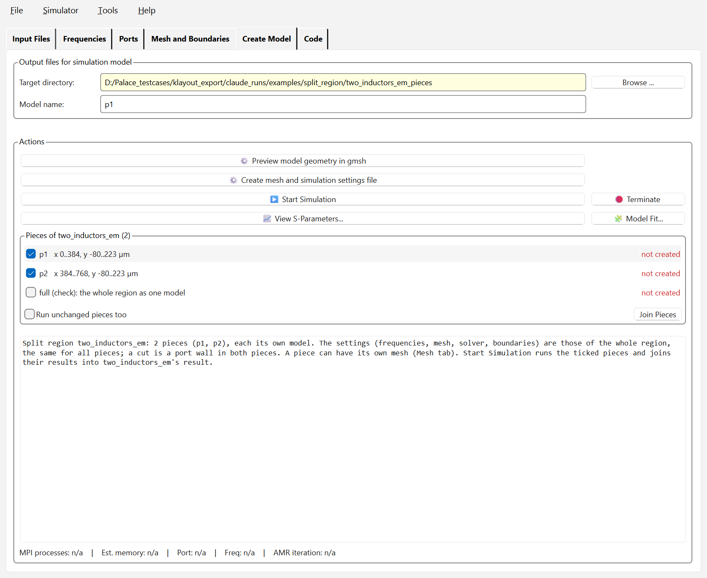

This needs gds2palace 0.10.1 and setupEM 0.18.1 or newer. Where to cut and where not: "Splitting the region into
pieces" in chapter 8 of the user's guide.

### Reference results

`split_region/reference/` holds the results of this layout from the validation of split regions (Palace 0.18,
`SG13G2_FEM_200um.xml`, surface conductor model, 0 to 60 GHz in 1 GHz steps, refined cell size 5 µm), both
calibrated at the port walls, with the 0 Hz point:

| File | Content |
| --- | --- |
| `two_inductors_joined.s2p` | joined from the pieces p1 and p2 |
| `two_inductors_full.s2p` | the whole region as one model |

The joined result follows the full model over the whole sweep:

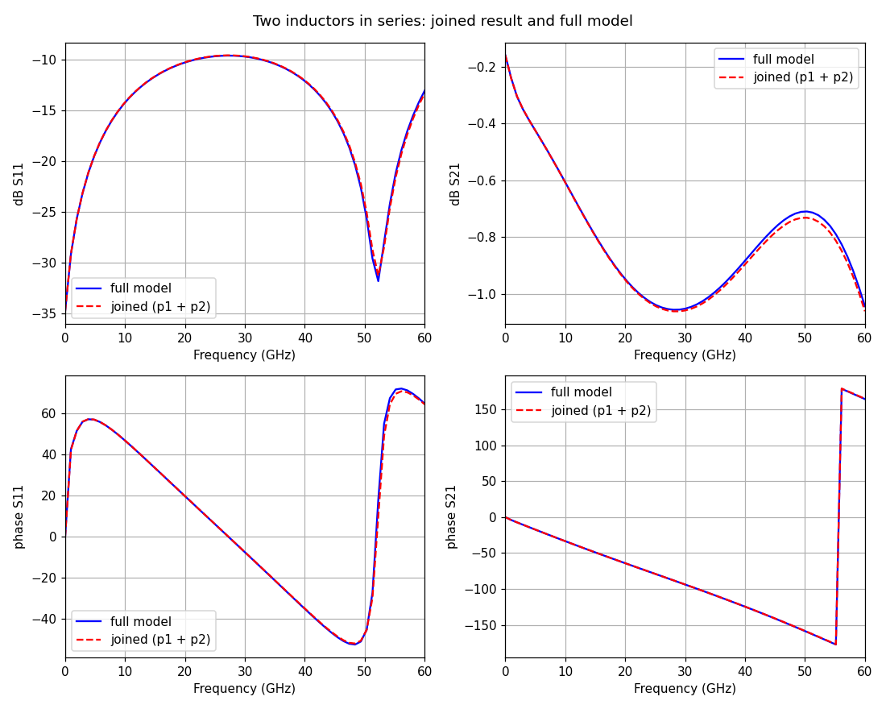

In this layout the two agree within the mesh noise of the full model, e.g. L at 5 GHz 0.6558 nH joined and
0.6560 nH full. L and Q here are those of the series impedance (−1/Y21): effective values of two coils, the line and
the capacitance to the plate, meaningful only well below the resonance.

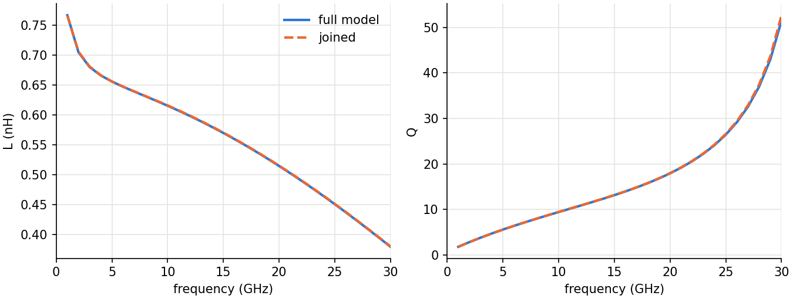

What a cut misses is coupling between the pieces other than through the lines that cross it: the cut is a metal wall
in both pieces. Here the plate between the cutouts shields the coils from each other, so there is little to miss.

## Remaking the images

The split region screenshots come from `doc/userguide/capture/capture_examples.py` (KLayout) and
`capture_setupem_set.py` (setupEM, with the export of the first), the S-parameter figure from `plot_examples.py`;
the cascode images are the user's guide's own.
