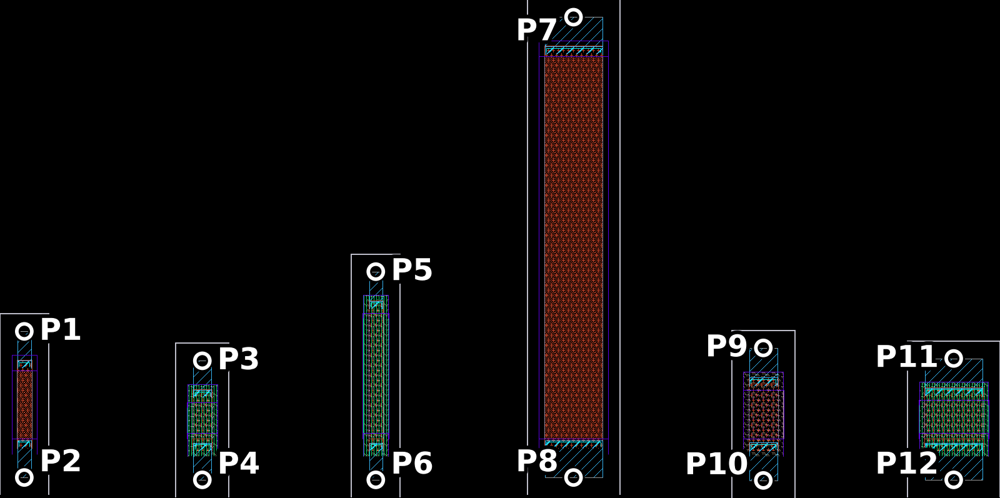

# PDK resistors as EM sheets: Palace vs. PDK value

Why the plug-in replaces resistors by default. The IHP SG13G2 PDK computes a resistor as

R = Rsh · l / (w + Δw) + 2 · rz / w

(pcell `CbResCalc` and the ngspice models agree). Δw is a width offset (rsil +0.01 µm, rppd +0.006 µm, rhigh
−0.04 µm), rz an end resistance at each contact head (rsil 4.5, rppd 35, rhigh 80 Ω·µm). The gds2palace stackup
builds the resistor sheets from the drawn layers (`RSIL`, `RPPD`, `RHIGH` derived layers) with the nominal Rsh: no
width offset, and of the end resistance only what the Cont vias contribute.

## The test

Six PDK resistor cells, as drawn, each between two via ports (Metal1 lead → Metal2 plate), like
`gds2palace_ihp_sg13g2/more_examples/derived_layers_and_resistors`: the three resistors of the cascode example and
the three of that gds2palace example. Palace 0.18 on hpz2, R = −1/Y12 of each port pair at 10 MHz.

| Cell | w × l (µm) | PDK (cell label) | Palace | Error |
| --- | --- | --- | --- | --- |
| rhigh (cascode, 3 kΩ) | 0.655 × 1.245 | 2997 Ω | 2599 Ω | −13.3 % |
| rppd (gds2palace example) | 1 × 1.665 | 500.3 Ω | 441.9 Ω | −11.7 % |
| rhigh (cascode, 13 kΩ) | 0.5 × 4.29 | 13.00 kΩ | 11.69 kΩ | −10.1 % |
| rhigh (gds2palace example) | 2 × 1.325 | 999.4 Ω | 905.6 Ω | −9.4 % |
| rsil (cascode, 50 Ω) | 0.5 × 2.33 | 49.98 Ω | 48.85 Ω | −2.3 % |
| rsil (gds2palace example) | 2 × 13.06 | 49.98 Ω | 49.88 Ω | −0.2 % |

rhigh and rppd come out 9 % to 13 % low. Both corrections are fixed amounts, so small resistors are hit hardest:
narrow ones by the width offset (rhigh 0.5 µm: −8 % from Δw alone), short ones by the end resistance (rhigh
0.655 × 1.245 µm: rz is 8 % of R). rsil is close because the Cont vias in the EM model happen to make up for most
of its end resistance; its low sheet resistance makes the contacts matter.

## Files

- `make_gds.py`: builds `resistor_test.gds` (ports 2k+1, 2k+2 per cell) and `resistor_test.json` from the cascode
  example (`D:\Palace_testcases\klayout_export\guide\cascode.gds`, made by the guide's capture script) and the
  gds2palace example GDS.
- `palace_resistor_test.py`: the gds2palace model script (from the gds2palace example, 12 ports, 0 to 1 GHz).
- `SG13G2_resistors_200um.xml`: the stackup of the gds2palace example (resistor layers, Cont and Metal1/2 identical
  to `XML_stackup/latest/IHP/SG13G2_FEM_200um.xml`).
- `port-S.csv`: the Palace result; `python evaluate.py port-S.csv resistor_test.json` prints the table.
